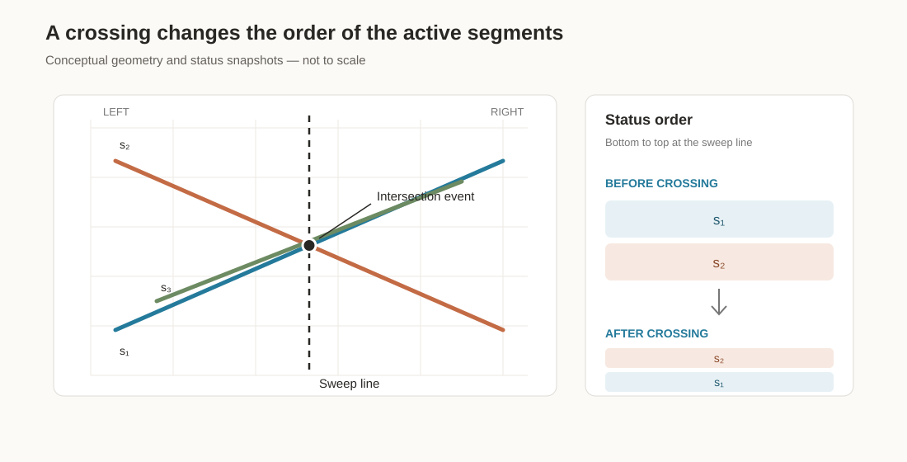
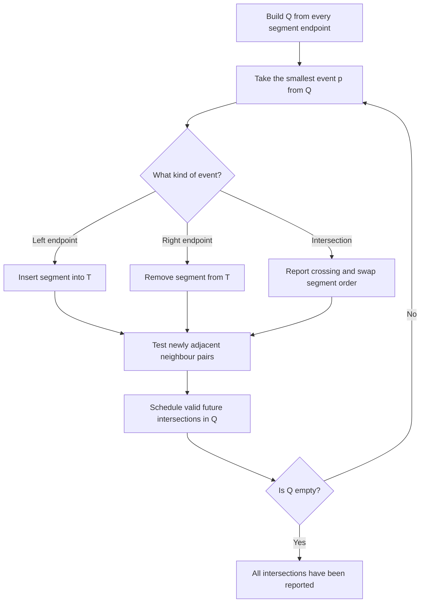

# Bentley–Ottmann: find every crossing without checking every pair

- **Stable ID:** `SA-GEO-BENTLEY-OTTMANN`
- **Domain:** Computational geometry / vector topology
- **Status:** researched algorithm record; restricted Python teaching implementation published
- **Version:** 0.1
- **Source inventory location:** Compendium, section 1, page 1; listed under segment intersection
- **Related records:** [Segment intersection](segment-intersection.md), [Point in polygon](point-in-polygon.md), planar arrangements, robust predicates
- **Prerequisites:** line segments, pairwise segment intersection, sorting, priority queues, balanced search trees

## 1. Start here

Imagine a map containing ten thousand straight road segments. You want to find every place where two of them cross.

The direct approach checks every pair. That is reliable but can mean nearly fifty million comparisons. Bentley–Ottmann takes a different approach: it moves an imaginary line across the map and concentrates on the segments that are neighbours along that line.

The key idea is local: **the next crossing can only happen between segments that are adjacent immediately before they cross.**

## 2. The problem

Given a set of $n$ line segments in the plane, report every intersecting pair (or, with an explicitly defined output convention, every intersection point).

Let $k$ be the number of intersecting pairs reported. The classical Bentley–Ottmann algorithm has an output-sensitive running-time bound:

$$
O\big((n+k)\log n\big)
$$

This is not a promise that every implementation with the same name achieves that bound. The bound depends on the data structures, event handling and assumptions described below.

The algorithm is about **all-segment intersection**. It builds on the pairwise predicate documented in [segment intersection](segment-intersection.md), but it does not simply run that predicate on every possible pair.

## 3. The simple idea

Picture a vertical line moving from the far left of the map to the far right.

At any moment, some segments cross that line. Keep those active segments in bottom-to-top order. Also keep a queue of events that can change this order:

- a segment begins at its left endpoint;
- two active segments meet;
- a segment ends at its right endpoint.

When a segment enters or leaves, only its immediate neighbours can have become newly relevant. When two segments cross, they exchange their order; again, only the neighbours around that exchange need new intersection checks.

The sweep does not inspect every pair. It maintains just enough local information to discover the next event.

*Figure 1. A conceptual snapshot. The dashed vertical line is the sweep line. The two highlighted segments meet at the event point; their vertical order changes as the sweep passes the crossing. The drawing is schematic, not to scale.*

## 4. In one minute

Two coordinated structures carry the algorithm:

1. **Event queue $Q$** — a priority queue ordered from left to right (with a defined tie-break for equal coordinates). It begins with all segment endpoints. Candidate intersection events are added as the sweep discovers them.
2. **Status $T$** — an ordered structure containing the segments intersected by the current sweep line, sorted by their height at the sweep position.

The algorithm repeatedly removes the next event from $Q$, updates $T$, and tests only pairs that have just become neighbours.

## 5. Formal foundations

### 5.1 Input and output

Each input segment has two distinct endpoints in a Cartesian plane. For the classical presentation, write its left endpoint as $p_i$ and its right endpoint as $q_i$, where:

$$
p_i.x < q_i.x
$$

The algorithm reports intersecting segment pairs. If several segments meet at the same geometric point, an implementation must decide whether the output is one point with a set of incident segment IDs, or multiple intersecting pairs. Those are different output contracts.

### 5.2 The sweep position

Let the sweep line be the vertical line:

$$
L_x = \{(x,y) : y\in\mathbb{R}\}
$$

As $x$ increases, the sweep line moves from left to right. Between consecutive event positions, no active segments exchange vertical order.

For a non-vertical segment with endpoints $(x_1,y_1)$ and $(x_2,y_2)$, its height at sweep coordinate $x$ is:

$$
y(x)=y_1+\frac{y_2-y_1}{x_2-x_1}(x-x_1)
$$

The status structure orders active segments by this height. A real implementation must avoid a comparator whose ordering silently changes while elements remain inside an ordinary balanced tree. The ordering changes only at known crossing events, and the data structure must be updated consistently at those events.

### 5.3 Neighbourhood

Two segments are neighbours in the status if no other active segment lies between them vertically. A pair that is not adjacent cannot be the next pair to cross: before those two segments can meet, the vertical order must change through a crossing involving segments between them.

This is the reason the algorithm can test newly adjacent pairs rather than all pairs.

## 6. The method

### 6.1 Initialise the event queue

Insert both endpoints of every segment into $Q$. Endpoint events are known before the sweep starts. Intersection events are discovered during the sweep and inserted when an adjacent pair is found to intersect to the right of the current event.

### 6.2 Process the next event

Let $p$ be the next event point. In the simple general-position presentation, one event involves either one endpoint or one crossing pair.

- **Left endpoint:** insert the segment into $T$ at its correct vertical position. Test the new segment against its immediate neighbour above and its immediate neighbour below.
- **Right endpoint:** remove the segment from $T$. Its former neighbours may now be adjacent; test that newly adjacent pair.
- **Intersection:** report the crossing, exchange the order of the two crossing segments in $T$, then test the newly adjacent pair above and the newly adjacent pair below.

Only schedule an intersection if it lies strictly after the current event in the queue's ordering. This prevents rediscovering an event that has already been processed.

### 6.3 Event-processing flow

Figure 2. The control flow. The exact event grouping and tie handling become more involved when multiple events share the same coordinates.

### 6.4 The status changes at a crossing

Immediately before two segments cross, one is directly above the other in $T$. Immediately after the crossing, their order is reversed. The status must represent that reversal before the algorithm checks the newly formed neighbouring pairs.

A common implementation mistake is to mutate the sweep coordinate and let a generic tree comparator change its answers behind the tree's back. That can invalidate the tree's internal ordering. A correct implementation must use a data structure and event-update strategy designed for this changing order.

## 7. Why the algorithm finds every intersection

The proof relies on the status order matching the true bottom-to-top order of the active segments between events.

Suppose two segments intersect at a point that has not yet been reported. Immediately before their first intersection along the sweep direction, they must be adjacent in the status: if another active segment lay between them, that segment would have to cross one of them earlier, creating an earlier event.

The algorithm checks a pair whenever the pair becomes adjacent. Therefore, the intersecting pair is tested and its future intersection is scheduled. Processing the event reports it.

This is the central correctness argument. It depends on consistent event ordering and on the assumptions that make the status order unambiguous.

## 8. Complexity

Let:

- $n$ = number of input segments;
- $k$ = number of intersecting pairs reported.

There are $2n$ endpoint events and, under the standard general-position assumptions, at most $k$ intersection events. Thus the number of processed events is $O(n+k)$.

With a priority queue and balanced status structure, each event and each constant number of neighbour updates costs $O(\log n)$. The resulting classical bound is:

$$
T(n,k)=O\big((n+k)\log n\big)
$$

The status and endpoint data require $O(n)$ space; the event queue can contain additional candidate events. Queue-space bounds depend on the implementation's policy for stale events and deletion.

Compare this with testing all pairs:

$$
T_{\text{brute force}}(n)=\binom{n}{2}
=\frac{n(n-1)}{2}
=O(n^2)
$$

When $k$ is small, the sweep can avoid most pair tests. When almost every pair intersects, $k=\Theta(n^2)$ and the output itself is quadratic.

**Implementation warning:** a Python teaching version using a plain list for status insertion/removal does not achieve the classical bound. Its measured and theoretical costs must be stated separately from the abstract algorithm.

## 9. Assumptions and degeneracies

The clean textbook algorithm is commonly introduced under general-position assumptions. A representative set is:

- no vertical segments;
- no two segments share an endpoint;
- no three segments meet at one point;
- no two distinct event points have the same sweep coordinate;
- no collinear overlapping segments.

These assumptions simplify the event queue and make each crossing a swap of exactly two segments. They are not guaranteed by ordinary GIS data.

| Input condition | Why the simple presentation struggles | What a robust implementation must define |
|---|---|---|
| Vertical segment | It intersects the sweep line over a range of heights at one x-coordinate | A special vertical-event policy or a mathematically consistent transformation |
| Shared endpoints | Several endpoint events coincide | Whether endpoint contact counts, and how all incident segments are grouped |
| Multiway crossing | More than two segments meet at one event point | Process the full incident set together, not a sequence of arbitrary pair swaps |
| Equal x-coordinates | Several events occur on the same sweep position | A total event order or grouped processing rule |
| Collinear overlap | Segments share an interval, not an isolated crossing point | An overlap-aware output model and event strategy |
| Near-degenerate floating-point data | Tiny numerical errors can reverse orientation or event order | Robust predicates and carefully designed constructions |

A symbolic perturbation can be used in some computational-geometry designs to reason consistently about degeneracies, but it must be specified and implemented; it is not equivalent to adding an arbitrary floating-point epsilon.

The robust plane-sweep literature analyses the numerical sensitivity of the classical method. Do not assume that using exact orientation tests alone automatically makes every event construction, queue comparison and status update robust.

## 10. Worked example

Consider three segments:

- $s_1$: $(1,1)$ to $(9,7)$
- $s_2$: $(1,7)$ to $(9,1)$
- $s_3$: $(2,0)$ to $(8,7)$

Segments $s_1$ and $s_2$ enter at $x=1$. Segment $s_3$ enters later, at $x=2$. The status is kept in bottom-to-top order as each endpoint event is processed.

The first pair meets at $(5,4)$. Immediately before $x=5$, $s_1$ is below $s_2$; immediately after, it is above. The event makes the two segments exchange positions. Segment $s_3$ then intersects $s_2$ at $x=121/23$ and $s_1$ at $x=31/5$, two later, distinct x-coordinates. This gives the sweep more than one crossing event to process without introducing a three-way intersection.

The runnable example and its tests calculate the event coordinates exactly and compare the reported segment pairs against the independent pairwise oracle.

## 11. How to implement it without hiding the hard parts

A reliable implementation should be built in stages:

1. **Oracle first:** use the pairwise segment-intersection routine to compute the expected set of intersecting pairs for small inputs.
2. **Specify the input contract:** decide whether the first version supports only general-position segments or also endpoint contacts, verticals, multiway events and overlaps.
3. **Represent events explicitly:** include event coordinates, event type, and stable segment identifiers. Define tie ordering or grouped-event semantics.
4. **Use exact predicates:** avoid deciding event order from rounded coordinates. For integer endpoints, rational event coordinates can be represented with exact fractions, though this alone does not solve all robustness issues.
5. **Make status updates explicit:** remove/reinsert or swap affected segments at the event; do not let a changing comparator silently corrupt an ordered tree.
6. **Test against the oracle:** generate small segment sets, compare the sweep's output with all-pairs output, and retain every discovered failure as a regression test.
7. **Benchmark separately:** measure sparse and dense intersection cases. Report the actual data structure and its cost.

The restricted implementation is available at [Bentley–Ottmann with Python](../../implementations/python/bentley-ottmann/README.md), with an [intern-ready walkthrough](../../implementations/python/bentley-ottmann/implementation-walkthrough.md). It uses a heap for events and a Python list for status so the event logic stays visible. It is a teaching implementation, not a production solver, and it does not achieve the abstract balanced-tree time bound.

## 12. Tests: current coverage and what comes next

The current Python prototype has nine tests, including exact-coordinate assertions, contract checks, changing-status cases and seeded differential tests against the pairwise oracle. The next test expansion should cover:

- no intersections;
- one proper crossing;
- several independent crossings;
- one segment crossing many others;
- intersections at segment endpoints;
- shared endpoints;
- vertical segments;
- multiple segments meeting at one point;
- equal-x endpoint and intersection events;
- collinear overlap;
- duplicate segments;
- very close but distinct intersections;
- large integer coordinates;
- randomized small cases checked against the pairwise oracle.

Tests should compare canonical segment-pair identifiers, not just the number of reported intersections. Equal counts can conceal missing and duplicated pairs.

## 13. Applications

- Find all crossings in road, rail, utility and drainage linework.
- Identify candidate network junctions before topology construction.
- Detect parcel-boundary intersections and linework defects.
- Build planar arrangements used by overlay and map-generalisation workflows.
- Find candidate collisions in CAD and computer graphics.

The algorithm works in a planar coordinate system. Applying it directly to longitude/latitude coordinates without an appropriate projection or spherical treatment can produce misleading geometric results.

## 14. Have a go

1. Draw five segments and move a vertical sweep line across them. Record the active status order after every event.
2. Explain why testing only the neighbours of a newly inserted segment is sufficient under the general-position assumptions.
3. Construct an example where a crossing event causes two segments to exchange order.
4. Explain why a third segment passing through the same intersection point breaks the simple “swap two segments” event handler.
5. For $n=100$ and $k=10$, compare the number of events in the sweep with the number of pair tests in brute force. State what this comparison does and does not prove about runtime.
6. Design a test that would detect a stale intersection event left in the priority queue after the relevant pair is no longer adjacent.

## 15. References

1. Bentley, J. L. and Ottmann, T. A. (1979). “Algorithms for Reporting and Counting Geometric Intersections.” *IEEE Transactions on Computers*, C-28(9), 643–647. https://doi.org/10.1109/TC.1979.1675432. Original paper introducing the reporting algorithm and its plane-sweep approach.
2. Boissonnat, J.-D. and Preparata, F. P. (2000). “Robust Plane Sweep for Intersecting Segments.” *SIAM Journal on Computing*, 29(5), 1401–1421. https://doi.org/10.1137/S0097539797329373. Analyses numerical sensitivity and robust variants.
3. Goodrich, M. T. and Wenk, C. “Line Segment Intersection” lecture notes, University of California, Irvine. https://ics.uci.edu/~goodrich/teach/geom/notes/LineSweep.pdf. Presents the event queue, status structure, assumptions and complexity.
4. de Berg, M., Cheong, O., van Kreveld, M. and Overmars, M. *Computational Geometry: Algorithms and Applications*. Springer. Standard textbook treatment of plane-sweep algorithms and segment intersection.
5. User-supplied *Spatial Analysis Algorithms: Complete Compendium*, section 1, page 1. The source inventory identifies Bentley–Ottmann under segment intersection; see [source inventory](../../source-inventory/README.md).

## 16. What remains uncertain

- Which exact-arithmetic or robust arrangement library should serve as the production reference implementation?
- Should the repository's first sweep implementation support general-position input only, or should we begin with a grouped-event implementation that supports endpoint and multiway contacts?
- What output model should represent a multiway intersection and a collinear overlap?
- Which redistributable geospatial line dataset can serve as a benchmark with independently verified expected results?

## Change history

| Version | Date | Change | Author / contributor |
|---|---|---|---|
| 0.1 | 2026-11-13 | Initial researched algorithm record with sweep-line diagram and rendered equations | Project draft |
