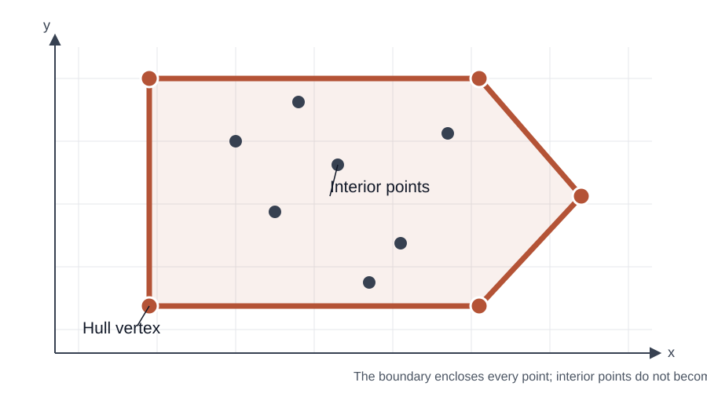

# Graham scan: find the boundary around a set of points

- **Stable ID:** `SA-GEOMETRY-GRAHAM-SCAN`
- **Kind:** algorithm
- **Domain:** computational geometry
- **Status:** researched teaching record; implementation and tests added; independent review pending
- **Version:** 0.1
- **Related records:** orientation test, monotone chain, gift wrapping, convex polygon

## The question

Given a collection of points, what is the smallest convex shape that contains them all?

Imagine stretching a rubber band around the points. When you let go, the band settles around the outside points. The boundary it forms is their **convex hull**.

Graham scan finds that boundary by sorting points around one carefully chosen starting point, then walking through them while removing turns that would bend inward or continue straight along an edge.

It is a useful first example of how sorting and a small geometric test can turn a collection of coordinates into a global shape.

## What the result means

The convex hull is the smallest convex set containing every input point. A polygon is convex when the line segment joining any two points in it stays inside the polygon.

The hull keeps the extreme points. Points strictly inside it do not appear on the boundary.

*The hull is the outer boundary. Interior points are part of the input, but not vertices of the result.*

## The turn test

For three points (A=(x_A,y_A)), (B=(x_B,y_B)) and (C=(x_C,y_C)), use the signed 2D cross product:

$$
\operatorname{cross}(A,B,C)
=(x_B-x_A)(y_C-y_A)
-(y_B-y_A)(x_C-x_A).
$$

Its sign tells us how the path turns:

- positive: counter-clockwise (a left turn);
- negative: clockwise (a right turn);
- zero: collinear (the points lie on one straight line).

This is an orientation test. It does not calculate an angle, and it is the central geometric operation in Graham scan.

## How the scan works

1. **Choose an anchor.** Select the point with the smallest y-coordinate; break ties by choosing the smallest x-coordinate. This point is on the hull.
2. **Sort by polar angle.** Order the remaining points by their angle around the anchor. For points on the same ray, sort by increasing distance.
3. **Start the stack.** Put the anchor and the first sorted point on the hull stack.
4. **Inspect each next point.** While the last two stack points and the candidate do not make a counter-clockwise turn, remove the stack's last point.
5. **Keep the candidate.** Add it to the stack and continue.
6. **Return the stack.** It describes the hull boundary in counter-clockwise order, without repeating the starting point.

The removal step is what makes the scan work: a right turn or a collinear middle point cannot be a necessary corner of the extreme boundary under this lesson's boundary policy.

## Why the anchor helps

Choosing the lowest point (and then the leftmost among ties) means every other point lies in the upper half-plane relative to the anchor. Their polar angles can therefore be ordered consistently without wrapping around the full circle.

The implementation uses `atan2` to make this ordering easy to inspect. A production implementation can compare half-planes and cross products instead, avoiding angle calculation and its associated floating-point considerations.

## A small example

Take the points:

$$
(0,0),\ (2,0),\ (3,1),\ (2,2),\ (0,2),\ (1,1).
$$

The point ((1,1)) lies inside the outer boundary. The hull is:

$$
(0,0)\rightarrow(2,0)\rightarrow(3,1)
\rightarrow(2,2)\rightarrow(0,2).
$$

The scan considers points in angular order. Whenever the next point would make the boundary turn clockwise or continue straight, it removes the previous candidate corner and tries again.

## Boundary policy in this implementation

There is more than one valid way to report points that lie on a hull edge. This teaching implementation returns only the extreme vertices:

- duplicate input coordinates are removed;
- interior points are excluded;
- points strictly between two hull vertices on a straight edge are excluded;
- a fully collinear input returns its two endpoints;
- zero, one or two unique input points are returned unchanged.

This policy is deliberate. If an application needs every input point along the hull boundary, it needs a different collinearity policy.

## Complexity

For (n) input points:

- finding the anchor takes (O(n));
- sorting takes (O(n\log n));
- the scan takes (O(n)), because each point is pushed once and removed at most once.

The total time complexity is therefore

$$
O(n\log n).
$$

The stack and sorted point list require (O(n)) additional storage.

## Where it can go wrong

| Situation | Why it matters | What to check |
|---|---|---|
| Duplicate coordinates | Repeated points can create redundant work or degenerate turns | Deduplicate before sorting |
| Several points on one ray | Their order affects which point survives | Sort near-to-far so the farthest can remain |
| Collinear boundary points | The output depends on the chosen boundary policy | State whether edge points are retained |
| Nearly collinear floating-point values | Rounding can change the sign of the cross product | Use suitable precision or a robust orientation predicate |
| Geographic longitude and latitude | Planar orientation may not represent geometry across large areas or the antimeridian | Project appropriately or use spherical/geodesic methods |
| Very large coordinates | Products in the cross product can overflow fixed-width integer types | Choose a numeric representation with adequate range |

## Graham scan and other hull algorithms

| Method | Main idea | When it is useful |
|---|---|---|
| Graham scan | Sort around an anchor, then scan with an orientation test | A clear (O(n\log n)) general-purpose teaching algorithm |
| Monotone chain | Sort lexicographically, then build lower and upper chains | Often simpler to implement; also (O(n\log n)) |
| Jarvis march (gift wrapping) | Repeatedly choose the next extreme point | Useful when the hull has few vertices relative to the input size |
| Quickhull | Recursively find points farthest from hull edges | Common practical approach; performance depends on point distribution |

These methods compute the same mathematical object but have different implementation structures and performance characteristics.

## Try it yourself

1. **Predict:** Add a point strictly inside the hull. Should the boundary change?
2. **Trace:** Write down the stack after each candidate point is processed.
3. **Change:** Add three points on the same ray from the anchor. Which one should remain?
4. **Compare:** Run Graham scan and monotone chain on the same random point sets. Compare the returned vertex sets, not just their order.
5. **Break it:** Try an empty input, repeated points, two points and a fully collinear set.
6. **Investigate:** Construct nearly collinear floating-point points and observe why robust orientation predicates matter.

## Runnable material

- [Python implementation, tests and walkthrough](../../implementations/python/graham-scan/README.md)
- [Implementation walkthrough](../../implementations/python/graham-scan/implementation-walkthrough.md)

## References

1. Graham, R. L. (1972). “An Efficient Algorithm for Determining the Convex Hull of a Finite Planar Set.” *Information Processing Letters*, 1(4), 132–133. [https://doi.org/10.1016/0020-0190(72)90045-2](https://doi.org/10.1016/0020-0190(72)90045-2)
2. Preparata, F. P., and Shamos, M. I. (1985). *Computational Geometry: An Introduction*. Springer.
3. de Berg, M., Cheong, O., van Kreveld, M., and Overmars, M. (2008). *Computational Geometry: Algorithms and Applications*, 3rd edition. Springer.

## Review still required

- Compare the implementation against an independent trusted hull implementation on generated and adversarial point sets.
- Decide and document the numeric precision contract for any production use.
- Add a visual notebook so learners can step through the stack changes.
- Check the rendered SVG and equations in GitHub before publication.

## Change history

| Version | Date | Change |
|---|---|---|
| 0.1 | 2026-11-14 | Initial lesson, teaching implementation and edge-case tests |
