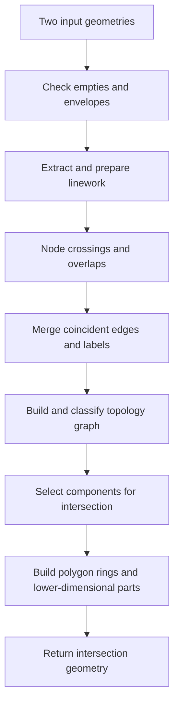

# Polygon intersection: what two areas have in common

*Planar vector overlay*

- **Stable ID:** `SA-GEO-POLYGON-INTERSECTION`
- **Domain:** Computational geometry / vector overlay
- **Status:** draft
- **Version:** 0.1
- **Source inventory location:** Compendium, section 1, “Core GIS: geometry, indexing, proximity, networks, routing”, page 1 (overlay operations; polygon clipping and segment intersection families continue on page 1)
- **Related records:** polygon union, difference, symmetric difference, segment intersection, point-in-polygon, noding, polygon validity, precision models
- **Prerequisites:** coordinate geometry, line segments, polygon rings, point-set topology

> Scope note: “intersection” can mean a segment-pair intersection test, an intersection-point construction, a Boolean predicate (`intersects`), or a full geometry overlay operation. This dossier focuses on **set-theoretic intersection of two planar vector geometries**, with polygon-polygon overlay as the main case. Segment intersection and Boolean predicates deserve their own linked records.

## 1. Start here

You have two mapped areas—perhaps a school catchment and a flood zone. You want to know which places belong to both.

**Polygon intersection finds the shared part.** Depending on how the boundaries meet, the answer might be an area, a line, a point or nothing at all. This is useful when comparing land parcels, service areas, habitats, hazards or any other mapped regions.

## 4. In one minute

For geometries $A$ and $B$, the intersection $A \cap B$ contains exactly the points that belong to both:

$$
A \cap B = \{x \mid x \in A \text{ and } x \in B\}.
$$

For two polygonal regions, the result is the shared area. Depending on how the boundaries meet, the full topological intersection may also contain line or point components. A robust overlay implementation must determine where boundaries cross or coincide, split linework at those locations (noding), classify the resulting pieces by their topological relationship to both inputs, and assemble the pieces that belong in the result.

## 2. The problem

Given two planar geometries A and B, compute a geometry representing their point-set intersection.

The output is not necessarily one polygon:
- disjoint polygons produce an empty result;
- overlapping polygon interiors produce polygonal area;
- polygons that touch only along an edge can produce a line;
- polygons that touch at one point can produce a point;
- multipart inputs can produce multiple disconnected components;
- mixed-dimensional inputs can produce heterogeneous results, depending on the geometry model and operation semantics.

Do not confuse the overlay operation `intersection(A, B)` with the Boolean predicate `intersects(A, B)`. The predicate answers whether the intersection is non-empty; the overlay constructs the intersection geometry.

## 3. The simple idea

Picture two transparent filled shapes laid over one another. Keep the places covered by both; remove everything covered by only one. That is the whole idea.

The hard part begins when their edges cross, touch, overlap or almost line up. A computer has to decide exactly where the shared region begins and ends, even though coordinates are stored with finite numerical precision.

### See how overlay operations differ

*Figure 1. “Vector Overlay Operators,” by Bplewe, Wikimedia Commons. Licensed under [CC BY-SA 4.0](https://creativecommons.org/licenses/by-sa/4.0/). Reproduced unchanged. The figure compares several common overlay operations; focus on the row labelled “intersect” for this lesson. [Source and licence record](https://commons.wikimedia.org/wiki/File:Vector_Overlay_Operators.png).

## 5. Formal foundations

For point sets A and B, intersection is the greatest set contained in both A and B. It is commutative and associative:

$$
A \cap B = B \cap A
$$

$$
(A \cap B) \cap C = A \cap (B \cap C).
$$

It is idempotent, and distributes over union:

$$
A \cap A = A
$$

$$
A \cap (B \cup C) = (A \cap B) \cup (A \cap C).
$$

These are mathematical set identities. A software geometry library may additionally impose representational rules for geometry collections, dimensional collapses, ring validity and precision. Those implementation semantics must be documented separately.

## 6. How a geometry engine works it out

The JTS OverlayNG documentation describes a graph-based overlay pipeline. In simplified, implementation-oriented terms:

1. Handle empty inputs and return the operation-appropriate empty geometry.
2. Extract input linework and points, retaining topological location labels.
3. Use envelope tests to reject disjoint inputs early; for intersection, clip/limit linework to the overlap envelope when the optimisation applies.
4. **Node** the linework: insert vertices at all relevant crossings so edges do not pass through unrepresented intersection points.
5. Merge coincident noded edges and combine their topological labels; detect topology collapses.
6. Build a labelled topology graph and propagate locations around graph nodes.
7. Select the graph components belonging to the requested operation.
8. Construct polygon rings, determine shell/hole nesting, and assemble polygons; separately extract any line and point components required by the operation's semantics.

This is a conceptual summary of the documented OverlayNG pipeline, not a claim that every geometry engine uses exactly these internal data structures or steps.

The diagram is a teaching-level map of the stages described above. It deliberately leaves implementation-specific optimisations and data structures out.

## 7. The smaller problems inside the operation

- **Envelope filtering:** quickly identify geometries whose bounding boxes cannot overlap.
- **Segment intersection:** detect crossings, endpoint touches and collinear overlaps.
- **Noding:** split linework so every intersection is represented as a vertex.
- **Coincident-edge handling:** merge duplicate edges while preserving labels from both inputs.
- **Topology classification:** determine whether each edge/area/point belongs to the intersection.
- **Ring construction:** link selected directed edges into rings and identify shells and holes.
- **Precision and robustness:** ensure numerical calculations do not produce inconsistent topology.

The source compendium lists polygon clipping families including Sutherland–Hodgman, Weiler–Atherton, Vatti and Greiner–Hormann, and separately lists Bentley–Ottmann for segment intersections. These are related algorithm families, not interchangeable names for the entire modern overlay pipeline. Their assumptions and supported polygon types need individual dossiers.

## 8. Correctness and guarantees

At the mathematical level, the target is the point-set intersection. At the implementation level, correctness also depends on:
- input validity requirements;
- geometry model and dimensional semantics;
- how coincident boundaries are represented;
- precision model and noding strategy;
- whether lower-dimensional topology-collapse components are retained;
- output validity and canonicalisation rules.

JTS OverlayNG documents valid output geometries and describes how intersection may include components of the same or lower dimension. Its strict mode changes whether lower-dimensional collapse results are included. Therefore, tests and downstream expectations must specify the chosen semantics.

## 9. Complexity

There is no single meaningful complexity bound for “polygon intersection” without specifying the algorithm, input representation, number of segments, number of actual intersections, spatial distribution, precision model and output size.

A naive all-pairs segment comparison performs quadratic candidate comparisons in the number of segments. Spatial indexes, monotone-chain indexing, sweep-line methods and envelope clipping can reduce work on many practical datasets, but actual complexity depends on candidate generation and the number of intersections. Record complexity for each concrete implementation or named algorithm separately; do not assign one universal Big-O figure to the entire overlay operation.

## 10. Numerical and geometric considerations

- **Planar versus geographic coordinates:** a planar overlay assumes a planar coordinate space. Choose an appropriate projected CRS when planar distances/areas or local topology are required; do not treat longitude/latitude degrees as uniform Cartesian units.
- **Floating-point arithmetic:** finite precision can misclassify near-collinear orientation, segment intersections and point-in-polygon relationships.
- **Precision model:** floating precision and fixed precision have different behaviour. Fixed precision may snap coordinates to a grid and can cause narrow features to collapse.
- **Snap tolerance:** snapping can improve robustness but can also alter geometry; tolerance must be justified in the units and scale of the data.
- **Invalid inputs:** self-crossing rings, duplicate edges, overlapping components and malformed holes may violate library preconditions.
- **Boundary cases:** coincident edges, vertex-on-edge contacts, tangencies, tiny slivers and near-zero-width intersections need explicit tests.
- **Dimensional collapse:** polygonal operations can yield line or point remnants under some semantics and precision models.

GEOS/JTS OverlayNG documents precision models, snap-rounding, noding choices and topology-collapse behaviour. It also warns that floating-precision noding may not be fully robust in all cases.

## 11. Try a small example

Let A be the square with corners (0,0), (4,0), (4,4), (0,4), and B the square with corners (2,1), (5,1), (5,3), (2,3).

Their intersection is the rectangle with corners:

- (2,1)
- (4,1)
- (4,3)
- (2,3)

Its area is \((4-2)(3-1)=4\) square coordinate units.

This simple example avoids degeneracies. It does not test coincident boundaries, holes, multipart geometries, invalid rings or floating-point robustness.

## 12. Software that provides this operation

| Library / implementation | Relevant API / method | Notes |
|---|---|---|
| GEOS | Geometry overlay / OverlayNG | C++ computational geometry library used by PostGIS, QGIS, GDAL and Shapely ecosystems |
| JTS | `Geometry.intersection`; OverlayNG | Java implementation; documentation describes explicit precision models and pluggable noding |
| PostGIS | `ST_Intersection` | SQL interface backed by GEOS for geometry overlay; verify version-specific behaviour before documenting |
| Shapely | `intersection` | Python interface to GEOS; record Shapely and GEOS versions in reproducible examples |

The first runnable reference is [Python with Shapely 2.1.2](../../implementations/python/polygon-intersection/README.md). It demonstrates the API and tests the expected geometry relationships; it does not reimplement the internal GEOS overlay algorithm. No benchmark is asserted here.

## 13. How we check the answer

Minimum test matrix for a reference implementation:

| Case | Expected property |
|---|---|
| Disjoint polygons | Empty intersection |
| Partial area overlap | Polygonal intersection with expected area |
| One polygon contained in another | Smaller polygon returned |
| Shared edge only | Lower-dimensional result according to documented semantics |
| Shared vertex only | Point result according to documented semantics |
| Multiple disconnected overlaps | Multiple components |
| Polygon with a hole | Hole respected in point-set result |
| Multipart input | Components handled according to API contract |
| Nearly coincident edges | Stable result or explicit robustness failure |
| Invalid self-crossing ring | Rejected, repaired or handled only as explicitly documented |
| Fixed precision | Output conforms to the chosen precision grid |
| Symmetry | A∩B topologically equals B∩A |

Useful invariants for valid inputs:
- result is a subset of A and a subset of B;
- intersection is commutative;
- intersection with an empty geometry is empty;
- intersection of A with A is topologically equal to A, subject to documented precision/canonicalisation semantics.

## 13. Alternatives and related methods

- Use `intersects` when only a yes/no answer is required; constructing the full overlay is unnecessary.
- Use envelope filtering or a spatial index to reduce candidate pairs in large workloads.
- Use a specialised clipping algorithm when its assumptions match the input (for example, clipping against a rectangle or convex clip polygon).
- Use coverage-specific union/overlay methods only when the input satisfies their coverage assumptions.
- Repair invalid geometries only under an explicit policy; repair can change the represented point set.

## 15. Where this is useful

- Clip administrative, environmental or planning layers to a study area.
- Find overlapping land parcels, service areas or hazard zones.
- Combine raster-derived vector boundaries with administrative regions.
- Identify shared areas between ecological, transport or infrastructure datasets.
- Construct planar arrangements and polygon partitions.

## 16. Have a go

1. Draw two overlapping rectangles and compute their intersection by hand.
2. Construct disjoint, containment, edge-touch and vertex-touch cases. Predict output dimension before running a geometry engine.
3. Explain why `intersects(A, B)` and `intersection(A, B)` are different operations.
4. Add a hole to one polygon. Predict which part of the candidate overlap should disappear.
5. Create a nearly coincident-edge case and compare floating and fixed precision behaviour.
6. Compare a naive segment-pair test with an indexed candidate-generation approach; report the number of candidate pairs, not just elapsed time.

## 17. References

1. JTS 1.20.0, OverlayNG package documentation: https://locationtech.github.io/jts/javadoc/org/locationtech/jts/operation/overlayng/package-summary.html
2. GEOS 3.15.0beta3, OverlayNG class documentation: https://libgeos.org/doxygen/classgeos_1_1operation_1_1overlayng_1_1OverlayNG.html
3. GEOS 3.15.0beta3, computational geometry algorithm namespace (robustness and performance notes): https://libgeos.org/doxygen/namespacegeos_1_1algorithm.html
4. JTS Feature Summary: https://dr-jts.github.io/jts-doc/features.html
5. User-supplied *Spatial Analysis Algorithms: Complete Compendium*, section 1, page 1. See [source inventory](../../source-inventory/README.md).

## 17. What we still need to investigate

- Which exact polygon clipping families should receive separate records first, and what input assumptions distinguish them?
- How should the project explain full-precision robust noding versus fixed-precision snap-rounding without implying one is universally superior?
- Which public implementation will be the first reproducible reference: Python/Shapely, Java/JTS, C++/GEOS or PostGIS SQL?
- Which CRS and precision examples best expose the practical difference between coordinate units, floating precision and snapping?

## Change history

| Version | Date | Change | Author / contributor |
|---|---|---|---|
| 0.1 | 2026-11-13 | Initial research draft; requires implementation and technical review | Project draft |
