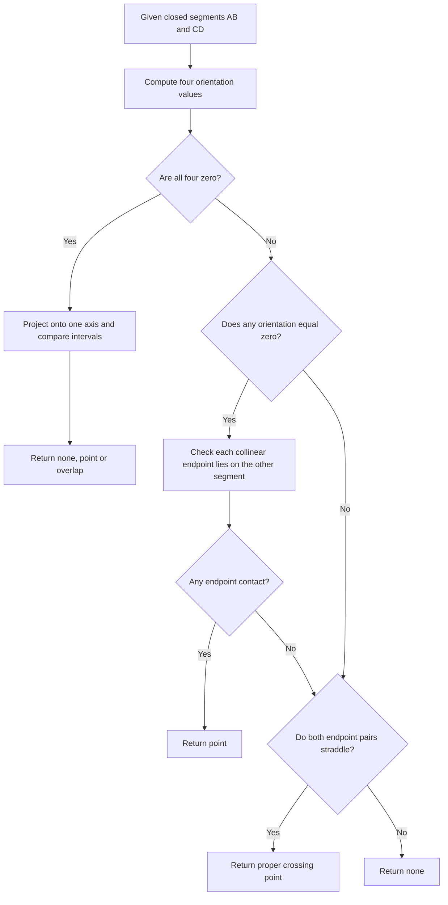

# Segment intersection: do these two lines meet?

- **Stable ID:** `SA-GEO-SEGMENT-INTERSECTION`
- **Domain:** Computational geometry / vector topology
- **Status:** research draft with tested exact-integer teaching implementation
- **Version:** 0.1
- **Source inventory location:** Compendium, section 1, “Core GIS: geometry, indexing, proximity, networks, routing”, page 1; lists segment intersection (Bentley–Ottmann)
- **Related records:** point in polygon, polygon intersection, line overlay, planar arrangements, robust predicates, spatial indexing
- **Prerequisites:** coordinate geometry, determinants, line segments

## 1. Start here

You have two roads drawn as straight lines on a map. Do they cross? Do they only meet at a junction? Or do they follow the same path for part of their length?

The same question appears when checking parcel boundaries, joining line networks, finding crossings in utility data or preparing polygon boundaries for an overlay operation.

For just two segments, we can test the relationship directly. When there are thousands of segments and we need every crossing, checking every possible pair becomes expensive. That larger problem leads to sweep-line algorithms such as Bentley–Ottmann.

## 2. The problem

A closed line segment is defined by two endpoints. Given segments AB and CD in the plane, determine their geometric intersection.

The result has three possible forms:

- **none** — the segments do not share any point;
- **point** — they cross or touch at exactly one point;
- **overlap** — they share a segment of positive length.

This is more precise than a yes/no answer. It distinguishes a proper crossing from an endpoint touch and from collinear overlap.

There are two related problem sizes:

1. **Pairwise segment intersection:** classify the relationship between one pair of segments.
2. **All-segment intersection:** given a set of n segments, report every intersecting pair or intersection point.

The first can be solved with a constant number of geometric predicates. The second is where plane-sweep methods become useful.

## 3. The simple idea: which side of a line?

Take a directed segment AB and a third point C. The orientation test tells us whether C is to the left of AB, to the right, or exactly on the same infinite line.

For two segments AB and CD, compare the orientations of C and D relative to AB, and A and B relative to CD.

If each segment's endpoints lie on opposite sides of the other segment's supporting line, the segments cross properly. If one of the orientation values is zero, we must check whether that endpoint actually lies within the other segment. If all four points are collinear, the problem becomes a one-dimensional interval overlap test.

### See the orientation test drawn out

The [Computational Geometry lecture notes from Universitat Politècnica de Catalunya](https://dccg.upc.edu/wp-content/uploads/2021/09/GeoC-Orientation-tests-R.pdf) show the left/right orientation test and how opposite-side tests identify a segment crossing. See the pages headed **Basic Tool: Orientation Tests**.

We link to the original slides rather than embedding their figures because a reuse licence was not established during this review.

The orientation test is the key building block. The boundary and collinear cases are not optional extras: without them, a segment-intersection routine will fail on ordinary map data.

This decision path separates the easy general-position case from the boundary cases that make a complete closed-segment predicate reliable.

## 4. Formal foundations

For points $A=(x_1,y_1)$, $B=(x_2,y_2)$ and $C=(x_3,y_3)$, define the orientation determinant:

$$
\operatorname{orient}(A,B,C) =
(x_2-x_1)(y_3-y_1) - (y_2-y_1)(x_3-x_1).
$$

Its sign gives the orientation:

- positive: C is counter-clockwise / left of directed AB;
- negative: C is clockwise / right of directed AB;
- zero: A, B and C are collinear.

For non-collinear configurations, a proper crossing occurs when:

$$
\operatorname{orient}(A,B,C)\,
\operatorname{orient}(A,B,D) < 0
$$

and

$$
\operatorname{orient}(C,D,A)\,
\operatorname{orient}(C,D,B) < 0.
$$

If any orientation is zero, use an on-segment test that checks both collinearity and coordinate bounds. If all four orientations are zero, sort endpoints along the common line and intersect the resulting one-dimensional intervals.

## 5. Pairwise method

For integer-coordinate endpoints, the teaching implementation follows this sequence:

1. Reject zero-length segments so the input contract stays explicit.
2. Compute the four orientation values.
3. If all four are zero, calculate the collinear overlap interval.
4. Check whether any endpoint lies on the opposite segment. This detects endpoint touches and collinear endpoint contacts.
5. If both orientation pairs have opposite signs, calculate the crossing point from the two supporting lines.
6. Otherwise return no intersection.

The orientation determinant uses integer arithmetic. For a proper crossing, the coordinate calculation can produce fractions, so the example uses exact rational arithmetic rather than rounding to a floating-point coordinate.

## 6. Correctness and guarantees

For two non-degenerate closed segments with integer endpoints, the implementation classifies disjointness, proper crossing, endpoint contact and collinear overlap using exact integer orientation tests and exact rational construction.

The contract is deliberately restricted:
- endpoints must be integer coordinate pairs;
- each segment must have two distinct endpoints;
- the geometry is planar and Cartesian;
- no tolerance or coordinate snapping is applied.

This does not establish a production-grade solution for arbitrary floating-point coordinates. A floating-point implementation must address roundoff in orientation and intersection construction. Shewchuk's adaptive-precision predicates are an important reference for robust orientation decisions.

## 7. Complexity

For one pair of segments, the algorithm performs a fixed number of arithmetic operations and comparisons: **O(1) time and O(1) auxiliary space**, treating integer arithmetic as constant-cost at the usual algorithm-analysis level. For very large integer coordinates, bit complexity is not constant.

For $n$ segments, testing every unordered pair requires:

$$
\binom{n}{2} = \frac{n(n-1)}{2} = O(n^2)
$$

pair tests. This simple method is worst-case optimal when the output itself contains Θ(n²) intersecting pairs, but it can do much more work than necessary when there are few intersections.

## 8. The bigger problem: finding every crossing

Bentley and Ottmann's 1979 algorithm uses a **plane sweep**. Imagine moving a vertical line from left to right across the map.

It maintains two main structures:

- an event queue ordered by the next endpoint or discovered intersection;
- a sweep-line status structure that keeps the segments currently crossing the sweep line in vertical order.

At a segment's left endpoint, insert it into the status structure and test its neighbours. At an intersection event, report the event, exchange the order of the crossing segments and test the newly adjacent neighbours. At a right endpoint, remove the segment and test the neighbours that become adjacent.

Under the algorithm's stated general-position assumptions, the standard reporting bound is:

$$
O((n+k)\log n)
$$

where n is the number of segments and k is the number of reported intersections. This is output-sensitive: when there are few intersections, it can avoid testing most segment pairs. In the worst case k can be Θ(n²), so the output itself can be quadratic.

The original presentation assumes away difficult degeneracies such as vertical segments, multiple segments meeting at one point and certain coincident events. A practical implementation must define event ordering and handle these cases explicitly. Do not present the clean general-position algorithm as a complete robust implementation for arbitrary GIS linework.

## 9. Numerical and geometric considerations

- **Orientation robustness:** a wrong sign near zero can change the topology of the result. Floating-point roundoff can cause an incorrect classification.
- **Exact integer predicates:** integer inputs permit exact determinant signs in arbitrary-precision integer languages such as Python, but output coordinates may still be rational.
- **Constructed intersections:** avoid silently rounding rational crossing points if later operations depend on exact topology.
- **Collinear overlaps:** these are not isolated point intersections; an API must return or otherwise represent the shared interval.
- **Endpoint contacts:** distinguish a shared endpoint from a proper interior crossing if downstream logic needs that distinction.
- **Multiway intersections:** several segments can meet at one point. An event queue must process all incident segments consistently.
- **Vertical segments and equal event coordinates:** event ordering and status comparisons need explicit tie-breaking.
- **CRS:** the example is planar. Longitude/latitude coordinates are not a uniform Cartesian plane.
- **Degenerate inputs:** zero-length segments are rejected by the teaching implementation.

Shewchuk (1997) explains why approximate orientation signs can fail near degeneracy and develops adaptive-precision predicates that refine calculations when the sign is uncertain.

## 10. Try a small example

Consider AB from (0,0) to (4,4), and CD from (0,4) to (4,0). The segments cross at (2,2).

Now change CD to (4,4)–(4,7). They meet at one endpoint, not in their interiors.

Finally, change CD to (2,2)–(6,6). The segments share a portion of the same diagonal. The result is an overlapping segment, not a single point.

The [Python example](../../implementations/python/segment-intersection/README.md) lets you run these cases and inspect exact rational coordinates.

## 11. Implementations

| Implementation | What it demonstrates | Important limit |
|---|---|---|
| Teaching Python function | Exact pairwise classification for integer-coordinate segments | Not a sweep-line algorithm; integer endpoints only |
| Bentley–Ottmann | Reports intersections among a set of segments using a plane sweep | Classical presentation assumes general position; degeneracies require careful handling |
| Robust predicates | Reliable orientation signs for floating-point inputs | Robust predicates do not automatically solve every construction or topology problem |

## 12. How we check the answer

The reference tests cover orientation signs, proper crossing, a rational-valued crossing, endpoint touch, collinear overlap, collinear touch, collinear disjointness, parallel segments, vertical crossing, reversed endpoint order and zero-length input rejection.

These tests validate the teaching implementation's stated integer-input contract. They are not a benchmark and do not validate a Bentley–Ottmann implementation.

## 13. Applications

- Detect crossings and shared portions in road, rail and utility networks.
- Find candidate intersections between parcel or administrative boundaries.
- Node linework before constructing planar arrangements or polygon overlays.
- Identify road/river crossings and infrastructure conflicts.
- Support collision detection and computer graphics.

## 14. Have a go

1. Draw two segments that cross properly and calculate the four orientation signs.
2. Construct two segments that meet at exactly one endpoint.
3. Construct collinear segments that are disjoint, touch at one point and overlap over a positive length.
4. Find two integer-endpoint segments whose crossing has non-integer coordinates.
5. Explain why an orientation test alone is not enough when one point is collinear with a segment's supporting line.
6. For n=1000 segments, calculate how many unordered pairs the brute-force method tests.
7. Explain why a sweep-line algorithm's running time depends on k, the number of reported intersections.

## 15. References

1. Bentley, J. L. and Ottmann, T. A. (1979). “Algorithms for Reporting and Counting Geometric Intersections.” *IEEE Transactions on Computers*, C-28(9), 643–647. https://doi.org/10.1109/TC.1979.1675432. The original paper develops algorithms for counting and reporting geometric intersections.
2. Shewchuk, J. R. (1997). “Adaptive Precision Floating-Point Arithmetic and Fast Robust Geometric Predicates.” *Discrete & Computational Geometry*, 18, 305–363. https://doi.org/10.1007/PL00009321. Explains adaptive-precision arithmetic and robust orientation predicates.
3. Goodrich, M. T. and Wenk, C. “Line Segment Intersection” lecture notes, University of California, Irvine: https://ics.uci.edu/~goodrich/teach/geom/notes/LineSweep.pdf. Provides a readable plane-sweep walkthrough, including the general-position assumptions and event/status structures.
4. User-supplied *Spatial Analysis Algorithms: Complete Compendium*, section 1, page 1. See [source inventory](../../source-inventory/README.md).

## 16. What remains uncertain

- Which robust sweep-line implementation should be used as the first reference implementation for arbitrary GIS linework?
- How should the project represent multiway intersections and overlapping segments in a future all-segment API?
- Which exact-predicate library should be compared with the integer/rational teaching implementation?
- Which real geospatial dataset provides a useful, redistributable benchmark with known ground truth?

## Change history

| Version | Date | Change | Author / contributor |
|---|---|---|---|
| 0.1 | 2026-11-13 | Initial research draft with tested exact-integer pairwise implementation | Project draft |
