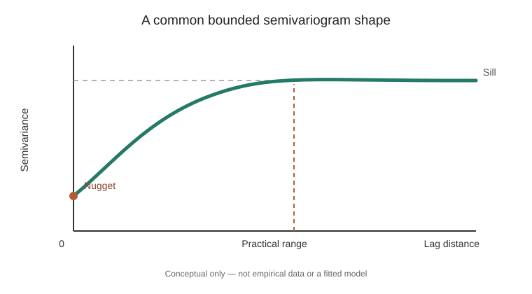

# Spatial interpolation: from nearby observations to an estimated surface

Stable ID: `SA-STAT-SPATIAL-INTERPOLATION` · Draft 0.1 · Source compendium section 3, page 4

## The problem

You have measurements at a set of locations, but need an estimate somewhere you did not measure. Examples include rainfall between gauges, soil properties between samples, noise levels between monitors or temperature at a location without a sensor.

An interpolation method turns discrete observations into estimates at other locations. It does not create new measurements. Its output depends on the spatial model, sample design, coordinate system and assumptions.

## Two different starting points

**Inverse distance weighting (IDW)** says that nearby observations should generally have more influence than distant ones. It is a deterministic weighted average.

**Kriging** treats the observed values as a realization of a spatial random field. Its weights are derived from a covariance or semivariogram model and an unbiasedness constraint. It can return a model-based prediction variance.

They are not interchangeable, and neither is universally best.

## Inverse distance weighting

For target location $s_0$, observed locations $s_i$, values $z(s_i)$ and power $p>0$:

$$
\hat z(s_0)=
\frac{\sum_{i=1}^{n}d(s_0,s_i)^{-p}z(s_i)}
{\sum_{i=1}^{n}d(s_0,s_i)^{-p}}
$$

The power controls how quickly influence declines with distance. Larger $p$ concentrates weight more strongly on nearby samples. The optional search radius and neighbour count alter the support of the estimate, so they must be reported.

At an exact sample location, a common convention is to return the observed value directly. If no observation is eligible inside a specified radius, the estimate is undefined; the teaching implementation returns `None`.

## Ordinary kriging

Ordinary kriging assumes an unknown but constant mean over the domain and a specified stationary variogram. The weights are selected to minimise prediction variance subject to an unbiasedness constraint.

This repository's baseline uses the isotropic exponential semivariogram with zero nugget:

$$
\gamma(h)=
\begin{cases}
0 & h=0,\\
c\left(1-e^{-h/a}\right) & h>0,
\end{cases}
$$

where $c>0$ is the partial sill and $a>0$ is the distance scale. This is a modelling choice, not an automatic fit to the sample.

For $n$ observations, solve:

$$
\begin{bmatrix}
\Gamma & \mathbf 1 \\
\mathbf 1^T & 0
\end{bmatrix}
\begin{bmatrix}
\boldsymbol\lambda \\
\mu
\end{bmatrix}
=
\begin{bmatrix}
\boldsymbol\gamma_0 \\
1
\end{bmatrix}
$$

where $\Gamma_{ij}=\gamma(\lVert s_i-s_j\rVert)$ and $\gamma_{0,i}=\gamma(\lVert s_i-s_0\rVert)$. The final row enforces $\sum_i\lambda_i=1$.

The prediction and its model-based variance are:

$$
\hat z(s_0)=\sum_i\lambda_i z(s_i),
\qquad
\sigma_K^2(s_0)=\boldsymbol\lambda^T\boldsymbol\gamma_0+\mu.
$$

The variance is conditional on the selected variogram and its parameters. It does not include uncertainty from model selection or variogram fitting.

## What the variogram contributes

The semivariogram describes how expected squared differences change with separation. The nugget, partial sill, range and anisotropy determine different aspects of the spatial dependence. This baseline intentionally fixes a zero nugget and isotropic exponential form so the linear system can be studied without hiding the model behind a fitting routine.

*This is a schematic curve, not an empirical variogram or a fitted model.*

The [implementation](../../implementations/python/geostatistics/README.md) also calculates a classical empirical semivariogram from distance bins, reporting mean pair distance, semivariance and pair count. Empty bins remain visible. This is an exploratory isotropic method-of-moments summary, not a variogram fit. For the estimator, bin-edge convention, worked pair calculations and limits, see the separate [empirical semivariogram method record](../../methods/empirical-semivariogram.md).\n\nBefore applying kriging, inspect an empirical variogram, check whether the stationarity assumption is plausible, assess directional structure, and justify the model and parameters. Do not infer these from a single attractive map.

## Coordinate reference system and validation

Distances must be meaningful. Use a suitable projected CRS for a local or regional study, document units and inspect distortion. Do not use Euclidean distance directly on longitude/latitude degrees.

Evaluate predictions with spatially structured cross-validation. Randomly splitting nearby points between training and test sets can leak local spatial information and overstate generalisation to new areas. Report error metrics and the spatial separation represented by the holdout design.

## Limitations of the teaching package

The [Python implementation](../../implementations/python/geostatistics/README.md) contains a direct IDW estimator and a dense ordinary-kriging solver with the exponential model above. It does not fit variogram parameters, implement universal or co-kriging, handle anisotropy, block predictions, measurement error, nonstationarity or large-data approximations such as Vecchia/NNGP. Those deserve separate lessons and implementations.

## Exercises

1. Use the same samples and target with IDW powers 1, 2 and 4. Explain why the estimate moves.
2. Add a distant high-valued sample. Compare unrestricted IDW with a finite search radius.
3. Keep the observations fixed and change the kriging range scale. Explain how the weights and variance change.
4. Move the target toward an observed sample. Plot prediction and kriging variance along the path.
5. Plot the empirical semivariogram and annotate pair counts. Which lag bins are poorly supported?\n6. Design a spatial-block cross-validation split. Explain why a random split answers a different generalisation question.

## References

- Matheron, G. (1963), “Principles of geostatistics,” *Economic Geology*, 58(8), 1246–1266. https://doi.org/10.2113/gsecongeo.58.8.1246.
- Cressie, N. (1993), *Statistics for Spatial Data*, revised edition, Wiley.
- Chilès, J.-P. and Delfiner, P. (2012), *Geostatistics: Modeling Spatial Uncertainty*, 2nd ed., Wiley.
- [PyKrige documentation](https://geostat-framework.readthedocs.io/projects/pykrige/en/stable/).
- [GSTools documentation](https://gmd.copernicus.org/articles/15/3161/2022/).

**Scope:** a scoped introductory interpolation lesson and small teaching implementation, not a complete geostatistics chapter.
