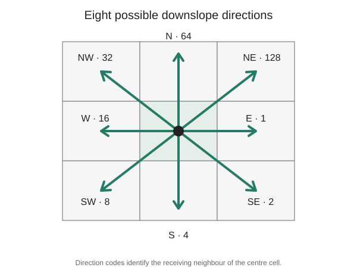

# D8 flow direction: where does water leave each cell?

- **Stable ID:** `SA-HYDROLOGY-D8-FLOW-DIRECTION`
- **Kind:** algorithm
- **Domain:** raster hydrology and terrain analysis
- **Status:** researched; teaching implementation and tests added; independent review pending
- **Version:** 0.1
- **Source inventory:** Section 4, pages 6–7 — flow routing
- **Related records:** D-infinity, multiple flow direction, depression filling, flow accumulation and watershed delineation (planned)

## Give every cell a way downhill

A digital elevation model (DEM) stores a height for each raster cell. To model where water may travel, we need a rule for deciding which neighbouring cell receives flow from each cell.

The D8 method looks at the eight neighbours around a cell and sends all of its flow to the neighbour with the steepest downslope gradient.

It is a simple, widely used starting point for raster hydrology. It also makes a strong assumption: each cell has one outgoing direction.

## See the eight choices

*D8 direction codes used by the ESRI-style convention. The code is a bit value representing the direction from the centre cell to its receiving neighbour.*

## The calculation

For a centre cell with elevation $z_c$ and a neighbouring cell with elevation $z_n$, the downslope gradient is

$$
g_n=\frac{z_c-z_n}{d_n},
$$

where $d_n$ is the distance between cell centres.

For square cells of width $r$:
- orthogonal neighbours are $r$ units away;
- diagonal neighbours are $r\sqrt{2}$ units away.

D8 selects the neighbour with the largest positive gradient. If no neighbour is lower, the cell is a sink or flat under this simple rule.

The direction code identifies the selected neighbour. In the ESRI-style convention, the eight codes are powers of two: 1, 2, 4, 8, 16, 32, 64 and 128.

## A worked cell

Suppose the centre cell has elevation 10. Its east neighbour is 9 and its southeast neighbour is 8. Let cell width be 1.

The east gradient is

$$
g_E=\frac{10-9}{1}=1.
$$

The southeast gradient is

$$
g_{SE}=\frac{10-8}{\sqrt{2}}\approx1.414.
$$

The diagonal is steeper, so the centre cell sends its flow southeast and receives direction code 2.

The largest elevation drop is not always the steepest path. Distance matters.

## What this teaching implementation does

The reference implementation:
- checks a rectangular elevation grid;
- supports rectangular cell dimensions;
- ignores NoData neighbours;
- chooses the neighbour with the greatest positive drop per unit distance;
- returns 0 for a cell with no strictly lower valid neighbour;
- returns `None` for a NoData cell;
- resolves exact ties using a documented fixed direction order.

It does **not** fill depressions, resolve flats, route across the raster edge, or reproduce every GIS package's tie and sink conventions. Those are separate hydrological preprocessing and routing decisions.

## From direction to a drainage network

Flow direction is usually an intermediate raster, not the final answer. A common workflow is:

1. inspect and condition the DEM;
2. identify or treat depressions and flats;
3. calculate flow direction;
4. calculate flow accumulation;
5. derive streams or channel networks using a stated threshold;
6. delineate catchments and validate against known drainage information.

A one-cell pit may be a measurement artefact, but it may also be a real closed depression. Filling every depression without considering the terrain and hydrological setting can change the drainage system.

## D8, MFD and D-infinity

| Method | How flow is represented | Main trade-off |
|---|---|---|
| D8 | All flow goes to one of eight neighbours | Simple and produces a single downstream path, but can create grid-direction bias |
| MFD | Flow is divided among multiple downslope neighbours | Represents divergent hillslope flow, but needs a partition rule |
| D-infinity | Flow follows the steepest direction on triangular facets in a 3×3 neighbourhood | Provides a continuous direction angle, then partitions flow between adjacent cells |

These methods answer related but different modelling questions. Do not treat their outputs as interchangeable.

## Where it can go wrong

| Situation | Why it matters | What to check |
|---|---|---|
| Depressions remain in the DEM | Flow can terminate in pits | Inspect sinks; decide whether they are real or artefacts |
| Flats are unresolved | Cells may have no strictly lower neighbour | Use a documented flat-resolution method |
| DEM has artefacts or voids | Local elevation errors can redirect flow | Check source quality, void handling and conditioning |
| Cell dimensions are ignored | Diagonal and orthogonal gradients are compared incorrectly | Use correct horizontal and vertical cell sizes |
| Grid alignment or CRS is wrong | Neighbour distances do not represent ground distances | Verify raster georeferencing and units |
| Tie handling differs between tools | Direction rasters may not match exactly | Document software conventions and compare on controlled tests |
| D8 is used for divergent hillslope flow | One receiver can over-concentrate flow | Compare MFD or D-infinity where appropriate |

## Complexity

For a raster with $R$ rows and $C$ columns, the local D8 calculation examines at most eight neighbours per valid cell. Its time complexity is $O(RC)$ and its output requires $O(RC)$ storage. The implementation uses a fixed-size neighbourhood, so the work per cell is constant.

This is the local direction step only. Depression filling, flat resolution, accumulation and watershed delineation have their own algorithms and costs.

## Try it

- **Predict:** A cell is 2 metres above an orthogonal neighbour and 3 metres above a diagonal neighbour. Which one is steeper for square cells?
- **Change:** Increase the cell height while keeping width fixed. What happens to diagonal distance?
- **Investigate:** Create a flat area. Which cells return 0 in this teaching version?
- **Compare:** Run a GIS tool's D8 output on the same DEM and inspect differences at ties, sinks and edges.
- **Build:** Add a flat-resolution procedure as a separate step. Keep the original DEM unchanged so the effect is visible.

## Runnable material

- [Python implementation, tests and walkthrough](../../implementations/python/d8-flow-direction/README.md)
- [Interactive D8 lab](../../notebooks/d8-flow-direction-lab.ipynb)

## References

1. Jenson, S. K., and Domingue, J. O. (1988). “Extracting Topographic Structure from Digital Elevation Data for Geographic Information System Analysis.” *Photogrammetric Engineering and Remote Sensing*, 54(11), 1593–1600.
2. Esri. [How Flow Direction works](https://doc.arcgis.com/en/arcgis-online/analyze/how-flow-direction-works.htm). Documents D8, MFD, D-infinity and implementation-specific sink, edge and direction-code behaviour.
3. Esri. [Flow Direction tool](https://doc.esri.com/en/arcgis-pro/latest/tool-reference/spatial-analyst/flow-direction.html). Documents D8 output codes, tie handling and drop calculations in ArcGIS Pro.

## What remains to be checked

- Compare the teaching implementation against an independent implementation on a shared DEM.
- Add explicit flat resolution and depression conditioning as separate lessons.
- Add flow accumulation and watershed delineation to complete the first raster-hydrology sequence.
- Use a documented DEM with clear provenance and licence before publishing a real geographic case study.

## Change history

| Version | Date | Change |
|---|---|---|
| 0.1 | 2026-11-13 | Initial D8 explanation, teaching implementation and interactive lab |
