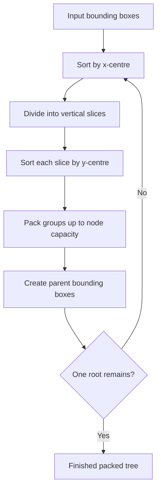
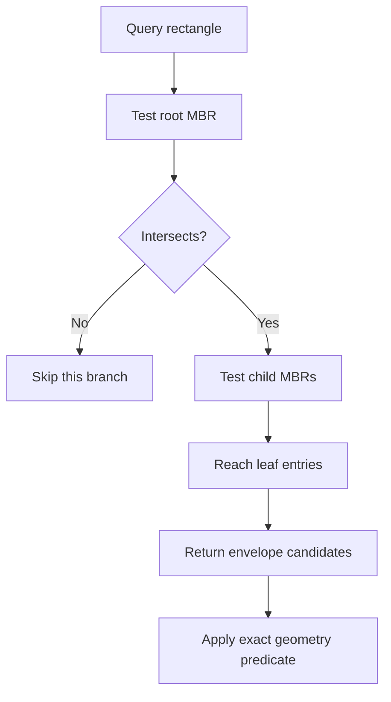

# STR-packed R-tree: find likely matches without checking everything

Stable ID: `SA-INDEX-STR-PACKED-RTREE` · Draft 0.1 · Source compendium section 1, page 1

## Start with a familiar problem

You have a citywide layer containing thousands of parks, buildings or service areas. A user asks which features overlap a small search window.

You could compare the window with every feature. That works, but it repeats work for places that are nowhere near the query.

A spatial index helps you skip large parts of the dataset.

**An R-tree organises bounding boxes into a hierarchy, so a query can rule out groups of geometries before checking individual features.**

This lesson focuses on an immutable, packed R-tree built with the Sort-Tile-Recursive (STR) method.

## What is a bounding box?

A geometry can have a complicated shape. Its minimum bounding rectangle (MBR) is the smallest axis-aligned rectangle that contains it.

For a 2D geometry, the bounds are:

$$
B = (x_{min}, y_{min}, x_{max}, y_{max})
$$

The index stores these rectangles rather than testing the full geometry at every tree level.

Two boxes intersect when neither is completely to the left, right, above or below the other. For closed rectangles, touching at an edge or corner counts as an intersection.

The key trade-off is that bounding boxes are fast to compare, but they are only an approximation of the original geometry. A candidate returned by the index may still fail the exact geometry predicate.

## How an R-tree is organised

An R-tree groups nearby entries into nodes. Every node stores a bounding rectangle that contains all its children.

- Leaf nodes point to individual geometry entries.
- Internal nodes point to other nodes.
- The root covers the entire indexed collection.

When a query does not intersect a node's rectangle, none of that node's descendants can match. The whole branch can be skipped.


*Diagram: “R-tree.svg” by Skinkie and Radim Baca, dedicated to the public domain. [Original file and rights statement](https://commons.wikimedia.org/wiki/File:R-tree.svg). Embedded from Wikimedia Commons without modification.*

The example shows the hierarchy of bounding rectangles. The actual grouping depends on the data and the packing strategy.

## Why use STR packing?

A dynamic R-tree can accept insertions and deletions. A packed R-tree is built from a known collection of entries and is then queried repeatedly.

STR stands for **Sort-Tile-Recursive**. It groups entries in a way that aims to keep nearby bounding boxes together and limit wasted space in the hierarchy.

For a two-dimensional collection:

1. Calculate the centre of every entry's bounding box.
2. Estimate how many leaf nodes are needed from the node capacity.
3. Sort the entries by their x-centres.
4. Divide them into vertical slices.
5. Within each slice, sort by y-centre.
6. Pack consecutive entries into leaf nodes.
7. Treat each leaf node's bounding box as an item and repeat the process for the next level.
8. Continue until one root node remains.

The process is recursive over levels, not recursive over individual geometry coordinates.

### The packing idea



The node capacity controls how many children a node may contain. A larger capacity creates wider, potentially shallower nodes; it does not guarantee faster queries. Data distribution and bounding-box overlap matter.

## Search: follow only branches that could match

To query the tree with a rectangle:

1. Start at the root.
2. If the query does not intersect the root's bounding box, return no candidates.
3. Otherwise inspect the root's children.
4. Skip every child whose bounding box does not intersect the query.
5. Descend into the remaining internal nodes.
6. At leaf nodes, return entries whose own bounding boxes intersect the query.

The output is a candidate set. If the original objects are polygons, lines or other geometries, apply the exact predicate to those candidates.



## A worked example

Suppose the tree contains these rectangles:

| Entry | Bounds |
|---|---|
| A | `(0, 0, 1, 1)` |
| B | `(2, 0, 3, 1)` |
| C | `(4, 0, 5, 1)` |
| D | `(0, 2, 1, 3)` |
| E | `(2, 2, 3, 3)` |

A query window from `(0.5, 0.5)` to `(2.5, 2.5)` intersects A, B, D and E. It does not intersect C.

A tree can use the parent rectangles to skip groups that cannot contain any of those four results. The final answer must still be checked against the original geometry if the stored bounds are only envelopes.

## Complexity and what affects performance

Let $N$ be the number of entries and $M$ the maximum number of children per node.

- STR packing sorts entries at each level. A typical bulk-loading build is dominated by sorting and is commonly described as $O(N\\log N)$.
- A balanced tree has a height on the order of $O(\\log_M N)$.
- A selective query often visits a small number of nodes, but the worst case is $O(N)$ when bounding boxes overlap heavily.
- The index stores the entries and the internal nodes, so storage is $O(N)$.

These are structural expectations, not a performance guarantee for every dataset. A large MultiPolygon with widely separated parts can have a large bounding box that overlaps many unrelated objects. Indexing its component polygons separately may produce better selectivity, when that is semantically appropriate.

## Try it with Python

The project includes a small STR-packed R-tree implementation for axis-aligned rectangles. It returns candidate indices and compares its output with a brute-force scan in the tests.

- [Python implementation](../../implementations/python/str-packed-rtree/README.md)
- [Step-by-step implementation walkthrough](../../implementations/python/str-packed-rtree/implementation-walkthrough.md)
- [Implementation source](../../implementations/python/str-packed-rtree/str_packed_rtree.py)
- [Tests](../../implementations/python/str-packed-rtree/test_str_packed_rtree.py)
- [Interactive notebook](../../notebooks/str-packed-rtree-lab.ipynb)

The teaching implementation is immutable and stores only 2D bounds. It does not implement dynamic insertion, deletion, nearest-neighbour search or exact geometry predicates.

## Use Shapely for real geometries

Shapely 2.1.2 exposes a query-only STRtree backed by GEOS:

```python
from shapely import STRtree, box

geometries = [
    box(0, 0, 1, 1),
    box(2, 0, 3, 1),
    box(4, 0, 5, 1),
]

tree = STRtree(geometries)
query_geometry = box(0.5, 0.5, 2.5, 2.5)

# Bounding-box candidates
candidate_indices = tree.query(query_geometry)

# Exact geometry predicate after index filtering
intersecting_indices = tree.query(
    query_geometry,
    predicate="intersects",
)
```

In Shapely 2.x, query results are integer indices into the original input sequence. This makes it possible to retrieve the geometry or any parallel record stored in the same order.

The tree is built at initialization and cannot be updated. Queries are two-dimensional: Z values are ignored by the index. The `dwithin` predicate requires GEOS 3.10 or newer.

## Important choices and failure modes

| Situation | What to check |
|---|---|
| Bounding boxes overlap heavily | The index may return many candidates and prune little |
| A geometry is long, sparse or multipart | Its MBR may be a poor approximation of its occupied area |
| Exact topological relationship is required | Refine candidates with the exact geometry predicate |
| Z coordinates matter | This STRtree indexes 2D bounds; it does not perform 3D spatial search |
| Data changes frequently | A query-only packed tree may be the wrong structure |
| Query uses distance | Use an appropriate distance query and a suitable projected CRS with meaningful units |
| Results are mapped back to records | Preserve the original input order or maintain a reliable index-to-record mapping |

## Have a go

1. Change the node capacity in the teaching implementation. Do the returned candidates change? Should they?
2. Create many overlapping bounding boxes. What happens to the number of candidates?
3. Create a concave polygon whose bounding box is much larger than its occupied area. Compare envelope candidates with exact intersections.
4. Use Shapely's `query()` with and without a predicate. Explain the difference.
5. Try a batch of query geometries and inspect the two-row index array returned by Shapely.
6. Compare STR packing with a dynamic R-tree. What workload would justify each?

## References

- Leutenegger, S. T., Edgington, J. M., and Lopez, M. A. (1997). “STR: A Simple and Efficient Algorithm for R-Tree Packing.” [NASA Technical Report PDF](https://ia600900.us.archive.org/27/items/nasa_techdoc_19970016975/19970016975.pdf).
- Shapely 2.1.2. [STRtree API reference](https://shapely.readthedocs.io/en/stable/strtree.html).
- Shapely. [STRtree in the user manual](https://shapely.readthedocs.io/en/stable/manual.html#str-packed-r-tree).

## Change history

| Version | Date | Change |
|---|---|---|
| 0.1 | 2026-11-13 | Initial reader-facing explanation and tested STR packing example |
