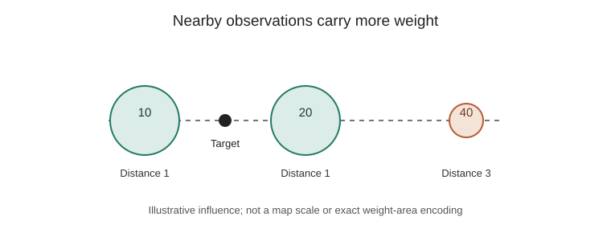

# Inverse distance weighting: estimating a value between observations

- **Stable ID:** `SA-INTERPOLATION-IDW`
- **Kind:** method
- **Domain:** spatial interpolation
- **Status:** researched; reference implementation and tests added; independent review pending
- **Version:** 0.1
- **Source inventory:** Section 3, page 4 — deterministic interpolation
- **Related records:** [Spatial weights matrix](../../methods/spatial-weights-matrix.md); ordinary kriging (planned)
- **Learning path:** [Interpolation and geostatistics](../../learning-paths/interpolation-and-geostatistics.md)

## You know a few places. What about the places in between?

Imagine you have rainfall measurements from a handful of weather stations. You can see what was measured at each station, but a map needs an estimate for the places where there is no station.

Inverse distance weighting (IDW) gives nearby observations more influence than distant ones. It is one of the simplest ways to turn scattered measurements into a continuous surface.

## What goes in, and what comes out?

You provide measured locations, their values, a target location, a distance rule and a power parameter. IDW returns a weighted average at the target. Repeat the calculation across a grid and you can create a raster surface.

IDW is deterministic. It does not estimate a probability model, explain why the pattern exists or automatically quantify prediction uncertainty.

## The simple idea

Think of each observation as contributing a vote. A nearby station gets a stronger vote. A distant station gets a weaker one. The power parameter controls how quickly that influence fades with distance.

*How distance changes influence in a small IDW example. Original diagram created for this lesson; values and geometry are illustrative.*

## The formula

For target location $s_0$, observed values $z(s_i)$ and distances $d(s_0,s_i)$:

$$
\hat z(s_0)=\sum_{i=1}^{n}\lambda_i(s_0)z(s_i)
$$

where

$$
\lambda_i(s_0)=
\frac{d(s_0,s_i)^{-p}}
{\displaystyle\sum_{j=1}^{n}d(s_0,s_j)^{-p}},
\qquad p>0.
$$

Here $n$ is the number of observations used, $p$ is the distance-power parameter and $\lambda_i$ is the normalized influence of observation $i$. The weights are non-negative and sum to one, so the estimate is a weighted average of the contributing values.

**A useful consequence:** the estimate cannot be lower than the smallest contributing value or higher than the largest. IDW does not create overshoots beyond the observations used for that estimate.

## Work through a small example

Three stations report values of 10, 20 and 40. Their distances from the target are 1, 1 and 3 distance units. Choose $p=2$.

The unnormalised weights are $1$, $1$ and $1/9$. Their sum is $19/9$, so the normalized weights are $9/19$, $9/19$ and $1/19$.

$$
\hat z(s_0)=
\frac{9}{19}(10)+\frac{9}{19}(20)+\frac{1}{19}(40)
=\frac{310}{19}\approx 16.32.
$$

The two equally close stations dominate. The farther station still contributes, but much less.

## What changing the power does

A small $p$ makes the weights more even. A larger $p$ concentrates influence around the closest observations. There is no universally correct power: the best choice depends on the variable, sampling pattern, distance definition and prediction task.

The number of neighbours and any search radius matter too. Using every observation lets distant points contribute weakly. A fixed number of nearest neighbours or a distance limit creates a local estimate, but may leave a target with no eligible observations.

## A practical workflow

1. Check observations, units, duplicates and missing values.
2. Choose a distance measure that matches the coordinate system and phenomenon.
3. Decide whether every observation or a local neighbourhood should contribute.
4. Select a starting power, often $p=2$, as a trial value—not a universal rule.
5. Predict at locations withheld from the interpolation.
6. Compare errors across candidate powers and neighbourhood choices.
7. Inspect residuals and maps for spatially structured errors.
8. Document the distance model, parameters, input CRS and validation design.

Random train/test splits can be misleading when nearby observations are strongly related. Spatially separated or blocked validation is often more informative about performance in new places.

## Where it can go wrong

| Situation | Why it matters | What to check |
|---|---|---|
| Longitude and latitude treated as planar coordinates | Euclidean degree distances are not uniform ground distances | Use an appropriate projected CRS or geodesic distance |
| A large power is chosen without testing | A few nearby points can dominate | Compare powers using held-out spatial locations |
| Sampling is clustered | Dense clusters can dominate estimates | Inspect sampling density and local support |
| A sharp boundary or barrier exists | Straight-line distance may connect unrelated places | Use a distance model that reflects the process, or choose another method |
| Strong directional structure exists | Ordinary Euclidean distance treats all directions equally | Investigate anisotropy |
| Measurements contain substantial error | Exact interpolation reproduces observed noise | Consider smoothing or a statistical model |
| Target is far outside the sample area | IDW still returns a number, but support is weak | Map distance to observations and mask unsupported areas |
| Several observations share a location | The inverse-distance expression is singular at zero | Resolve duplicates deliberately; this implementation averages coincident values |

## What IDW does—and does not—promise

IDW is easy to explain and fast to implement. It is exact at sampled locations under the usual zero-distance convention, and its positive normalized weights keep predictions within the range of contributing observations.

It does **not** choose its own best power, minimize prediction error by construction, model a variogram, account for physical barriers automatically or provide kriging-style prediction variance. A smooth-looking map is an estimate, not proof that the underlying phenomenon is smooth.

## Try it

- **Notice:** Why do the first two stations receive equal weights?
- **Predict:** Will increasing $p$ move the estimate closer to 10, 20 or 40?
- **Change:** Run the notebook with $p=1$, $p=2$ and $p=4$. What changes?
- **Investigate:** Remove the closest observation. Does the estimate become more sensitive to the farthest point?
- **Build:** Add a maximum search radius. What should happen when no observations fall inside it?
- **Evaluate:** Compare powers using spatially separated validation points. Report MAE and RMSE, and map the residuals.

## Runnable material

- [Python reference implementation, tests and walkthrough](../../implementations/python/inverse-distance-weighting/README.md)
- [Interactive IDW lab](../../notebooks/inverse-distance-weighting-lab.ipynb)

The reference implementation uses Euclidean distance in the units of the supplied coordinates. It is a teaching implementation, not a substitute for checking CRS, barriers, sampling design or prediction support.

## Alternatives

| Method | Main idea | Useful distinction |
|---|---|---|
| Nearest neighbour | Copy the value from the closest observation | Produces local constant regions |
| Natural neighbour | Use changes in a Voronoi/Delaunay neighbourhood | A local geometric construction |
| Splines and radial basis functions | Fit a smooth function through or near observations | Can produce smoother surfaces and may overshoot |
| Kriging | Use a spatial covariance or variogram model to derive weights | Makes spatial dependence explicit and can provide model-based prediction variance |

These methods are not interchangeable. Choose by the question, assumptions, data and validation results—not by which surface looks nicest.

## References

1. Shepard, D. (1968). “A two-dimensional interpolation function for irregularly-spaced data.” *Proceedings of the 1968 23rd ACM National Conference*, 517–524. [https://doi.org/10.1145/800186.810616](https://doi.org/10.1145/800186.810616). The original paper introduces an interpolation function for irregularly spaced observations.
2. Hengl, T. (2007). *A Practical Guide to Geostatistical Mapping of Environmental Variables*. European Commission, Joint Research Centre. [Open PDF](https://publications.jrc.ec.europa.eu/repository/bitstream/JRC38153/eur22904en.pdf). Section 1.2.1 describes inverse-distance interpolation and compares deterministic and statistical prediction.
3. SciPy documentation. [Interpolation overview](https://docs.scipy.org/doc/scipy/tutorial/interpolate.html) and [scattered-data interpolation](https://docs.scipy.org/doc/scipy/reference/generated/scipy.interpolate.griddata.html). These document alternatives; they are not an IDW implementation reference.

## What remains to be checked

- Independently review the derivation and duplicate-location policy.
- Compare the teaching implementation with a maintained geospatial library on a documented test set.
- Add a real, licensed dataset and spatial cross-validation example before making applied performance claims.
- Research natural neighbour, spline and radial-basis methods as separate records.

## Change history

| Version | Date | Change |
|---|---|---|
| 0.1 | 2026-11-13 | Initial researched lesson, reference implementation and interactive lab |
