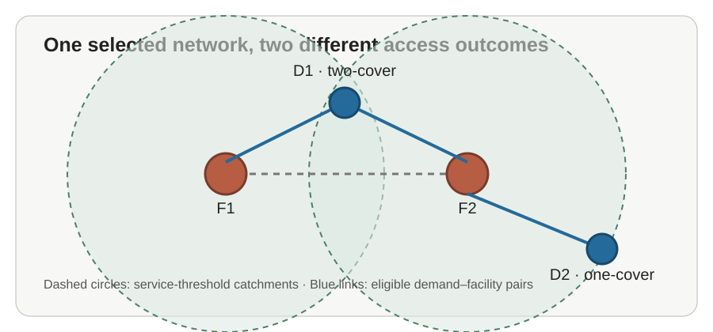

# Backup coverage: plan for loss of a nearby facility

Stable ID: `SA-OPT-BACKUP-COVERAGE` · Draft 0.1 · Location-science extension

## The planning question

A map may show a neighbourhood as served because one facility lies within the chosen travel-time threshold. But what happens if that facility closes temporarily, reaches capacity, loses power or becomes inaccessible? Backup-coverage models ask whether demand has more than one eligible facility nearby.

This lesson introduces a deterministic **r-covering** objective: maximize the demand weight that has at least $r$ distinct selected facilities within a stated service threshold. This is a restricted all-or-nothing formulation for teaching and small-instance verification. Hogan and ReVelle's original backup-coverage work considers trade-offs between first and backup coverage; this package does not reproduce every objective or variant in that literature.

## Define the model carefully

Let $I$ be demand locations and $J$ candidate facilities. Let $a_i\geq0$ be demand weight, $d_{ij}\geq0$ the impedance from demand $i$ to candidate $j$, $S$ the service threshold and $p$ the maximum number of facilities. Let $r\geq1$ be the required number of distinct selected facilities.

Define eligibility:

$
e_{ij}=\begin{cases}
1 & d_{ij}\leq S,\\
0 & d_{ij}>S.
\end{cases}
$

Let $x_j\in\{0,1\}$ indicate whether candidate $j$ is selected, and $y_i\in\{0,1\}$ indicate whether demand $i$ receives the required number of nearby selected facilities.

$
\max\quad \sum_{i\in I}a_i y_i
$

subject to

$
\sum_{j\in J} e_{ij}x_j\geq r y_i
\quad\forall i\in I,
\qquad
\sum_{j\in J}x_j\leq p,
\qquad
x_j,y_i\in\{0,1\}.
$

For $r=1$, the coverage condition reduces to ordinary maximal covering. For $r=2$, a demand location is counted only when at least two distinct selected candidates are within $S$.

## What this does and does not mean

Two facilities within a threshold are **potential alternatives**, not a guarantee of uninterrupted service. Hogan and ReVelle introduced backup coverage as a second-coverage criterion for emergency-service location. Other reliability formulations explicitly model facility busy fractions or disruption probabilities; the present implementation does not reproduce those probabilistic formulations. The simple model does not estimate facility failure probabilities, correlated outages, spare capacity, staffing, queues, road closures or the time needed to transfer service.

It also assumes that each selected candidate is a distinct facility. Duplicate candidate records must be reconciled before solving. If two facilities share a vulnerable power supply or bridge, treating them as independent backups can exaggerate resilience.

## Exact small-instance implementation

The [Python package](../../implementations/python/backup-coverage/README.md) enumerates candidate subsets up to $p$, counts eligible selected facilities for each demand row, and scores rows whose count is at least $r$.

For $m$ candidate facilities, the solver checks:

$
\sum_{k=r}^{p}\binom{m}{k}
$

subsets. This is an exact teaching baseline and a small-instance test oracle, not a metropolitan-scale optimiser.

## Workflow

1. Define the service and the failure or disruption scenario that motivates redundancy.
2. Build a directed or undirected cost matrix with explicit units and time period.
3. Set the service threshold $S$ and redundancy level $r$, and justify both.
4. Identify truly distinct candidate facilities and shared dependencies.
5. Solve and map demand with zero, one and at least $r$ eligible selected facilities.
6. Compare $r=1$ with $r=2$, and test changes to $p$, $S$, candidate eligibility and demand weights.
7. For operational resilience, extend the model with capacity, failure scenarios, probabilities and correlated-risk assumptions.

## Exercises

1. Use the lab to compare one-cover and two-cover demand under the same facility budget.
2. Find a demand point that is covered by one facility but not backup-covered.
3. Construct a case where two nearby candidate sites are not operationally independent because they share a vulnerable access route.
4. Change the cost matrix from symmetric distance to directed travel time.
5. Explain why a deterministic two-cover score is not the probability that service survives an outage.
6. Propose a scenario-based model with facility failures and identify what data it would require.

## References

- Hogan, K. and ReVelle, C. (1986), “Concepts and Applications of Backup Coverage,” *Management Science*, 32(11), 1434–1444. https://doi.org/10.1287/mnsc.32.11.1434
- Church, R. and ReVelle, C. (1974), “The maximal covering location problem,” *Papers of the Regional Science Association*, 32(1), 101–118. https://doi.org/10.1007/BF01942293
- Daskin, M. S. (2013), *Network and Discrete Location: Models, Algorithms, and Applications*, 2nd ed., Wiley.
- Snyder, L. V. (2006), “Facility location under uncertainty: a review,” *IIE Transactions*, 38(7), 547–564. https://doi.org/10.1080/07408170500216480

**Scope:** deterministic r-covering with finite candidate sites, non-negative weighted demand, a supplied cost matrix, one common threshold and an at-most-$p$ budget. It is not a stochastic reliability, queueing or capacitated-service model.
