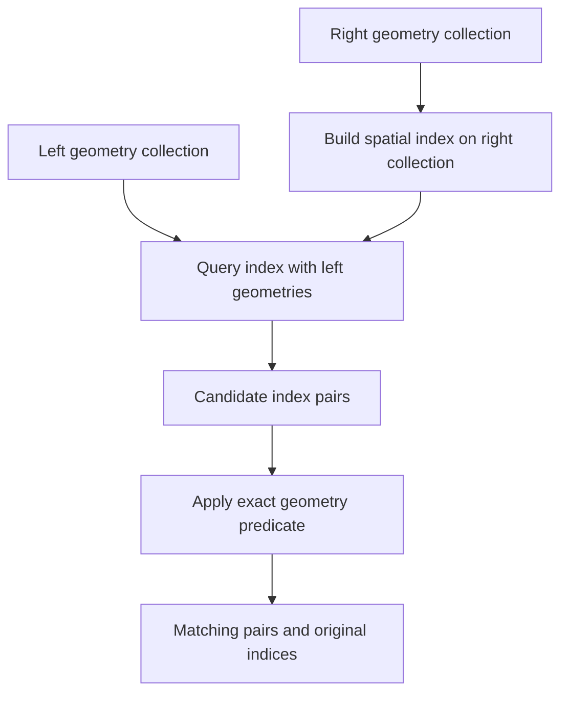

# Filter-and-refine spatial join: match two layers without comparing every pair

Stable ID: `SA-QUERY-FILTER-REFINE-SPATIAL-JOIN` · Draft 0.1 · Source compendium section 1, page 2

## Start with a practical question

You have a layer of customer locations and another layer of service areas. Which customers fall inside which areas?

Or you have roads and flood zones. Which roads intersect a flood boundary?

A direct approach compares every geometry in the first collection with every geometry in the second. That is easy to understand, but it can become expensive when both layers are large.

**A filter-and-refine spatial join uses an index to find possible matches first, then checks the exact spatial relationship only for those candidates.**

The result is a set of matching pairs. The index makes the search more selective; the geometry predicate decides what actually matches.

## The two collections

Let the left collection contain $n$ geometries:

$$
L = \{L_1, L_2, \ldots, L_n\}
$$

Let the right collection contain $m$ geometries:

$$
R = \{R_1, R_2, \ldots, R_m\}
$$

Choose an exact spatial predicate $P$, such as `intersects`, `within` or `contains`.

The spatial join result is:

$$
J = \{(i,j) \mid P(L_i,R_j)\}
$$

A brute-force join evaluates the predicate for every possible pair. That means (n\times m) exact geometry tests.

## Filter first: build a candidate set

An index such as an STR-packed R-tree stores bounding boxes. It can quickly identify pairs whose bounding boxes intersect.

Let $B(G)$ be the bounding box of geometry $G$. The candidate set is:

$$
C = \{(i,j) \mid B(L_i)\cap B(R_j)\ne\emptyset\}
$$

Every exact match must be in the candidate set, so:

$$
J \subseteq C
$$

But a candidate is not necessarily an exact match. A concave polygon, a polygon with holes or a multipart geometry can have a bounding box that covers empty space.

## Then refine: apply the exact predicate

For each pair in the candidate set, test the actual geometries:

$$
J = \{(i,j)\in C \mid P(L_i,R_j)\}
$$

This is the important separation:

- **Filter:** bounding boxes reduce the number of possible pairs.
- **Refine:** the exact geometry predicate decides which pairs belong in the join.

The filter must not remove a true match. It may return false positives, but the refine step removes them.

## The workflow



The index can be built on either side. Which side is indexed affects memory, build cost and query batching, but not the meaning of the final join if the pair direction is handled correctly.

## What does the predicate mean?

The spatial predicate is part of the question, not a cosmetic option.

For a point layer joined to a polygon layer:

| Predicate | What it asks |
|---|---|
| `within` | Is the point inside the polygon? |
| `intersects` | Does the point share any space with the polygon, including its boundary? |
| `covered_by` | Is no part of the point outside the polygon? |
| `contains` | Does the first geometry contain the second? This reverses the point/polygon direction |

Boundary behaviour matters. A point exactly on a polygon boundary is not within the polygon under the usual DE-9IM definition, but it does intersect the polygon. If boundary points should count as assigned, choose a predicate that expresses that rule.

## Shapely 2.x example

Shapely's STRtree can query an array of left geometries against an index built over the right geometries. Passing a predicate performs the exact refinement after bounding-box filtering.

```python
from shapely import STRtree, box
from shapely.geometry import Point

points = [
    Point(0.5, 0.5),
    Point(3, 3),
    Point(10, 10),
]

areas = [
    box(0, 0, 1, 1),
    box(2, 2, 4, 4),
]

tree = STRtree(areas)

# First row: index in points.
# Second row: index in areas.
pairs = tree.query(points, predicate="within")

matches = [
    (int(point_index), int(area_index))
    for point_index, area_index in zip(pairs[0], pairs[1])
]
print(sorted(matches))
```

The result is a pair of integer indices into the original input sequences. The order of the two rows is important: the query geometries come first, and the tree geometries second.

## How much work does the index save?

Without an index, the join performs (n\times m) exact predicate checks.

With a spatial index:
- build the index on one collection;
- query it with the other collection;
- refine only the candidate pairs.

If the index is selective, the candidate count can be much smaller than (n\times m). The actual cost depends on the tree structure, bounding-box overlap, query distribution and exact predicate.

The worst case is still $O(nm)$ when many bounding boxes overlap. If both collections contain $N$ geometries, that is $O(N^2)$. An index is not a guarantee of subquadratic performance.

For a packed tree, the build step is commonly dominated by sorting. A selective query often visits a small number of nodes, but benchmark the real workload rather than assuming every spatial join will be fast.

## Try it with the implementation

The accompanying implementation builds a Shapely STRtree over the right-hand collection and returns stable `(left_index, right_index)` pairs.

- [Python implementation](../../implementations/python/spatial-join/README.md)
- [Step-by-step implementation walkthrough](../../implementations/python/spatial-join/implementation-walkthrough.md)
- [Implementation source](../../implementations/python/spatial-join/spatial_join.py)
- [Tests](../../implementations/python/spatial-join/test_spatial_join.py)
- [Interactive notebook](../../notebooks/filter-refine-spatial-join-lab.ipynb)

The tests compare the indexed join with a brute-force join and cover boundaries, multiple matches, predicate direction, empty geometries and polygons with holes.

## Common mistakes

- **Using the wrong predicate direction.** Shapely evaluates the predicate as `predicate(input_geometry, tree_geometry)`.
- **Treating candidates as final matches.** Bounding boxes are not the original geometry.
- **Ignoring boundary rules.** `within`, `contains`, `covers` and `intersects` do not mean the same thing.
- **Losing record alignment.** Keep the geometry arrays in the same order as their associated IDs and attributes.
- **Mixing coordinate systems.** Shapely is planar and does not reproject geometries for you.
- **Assuming the index always helps.** Highly overlapping bounding boxes can make the candidate set almost as large as the brute-force pair set.

## Where it is useful

- assigning points to administrative areas or service zones;
- finding roads, buildings or parcels intersecting a hazard area;
- linking events to nearby infrastructure;
- matching environmental observations to catchments or management units;
- preparing candidate pairs for more expensive spatial analysis.

## Have a go

1. Change `within` to `intersects`. What happens to points on polygon boundaries?
2. Add a concave polygon and query its empty bounding-box area. Why does it appear in the candidate set?
3. Reverse the indexed side. How do the returned pair indices change?
4. Compare the indexed join with the brute-force implementation for 1,000 points and 100 polygons.
5. Measure candidate count divided by total possible pairs. What does that tell you about index selectivity?

## References

- Shapely 2.1.2. [STRtree query API](https://shapely.readthedocs.io/en/stable/strtree.html). The API documents bounding-box candidate filtering, exact predicate refinement and the two-row index result for array queries.
- Shapely. [Geometric predicates](https://shapely.readthedocs.io/en/stable/predicates.html).
- OGC. [Simple Feature Access](https://www.ogc.org/standard/sfa/), for the spatial predicate model.

## What this lesson does not claim

- The index does not change the meaning of the exact predicate.
- The filter stage may return false positives, but it must not discard true matches.
- The index does not reproject coordinates or validate the source geometries.
- A spatial join is not automatically a nearest-neighbour join or a distance join; those require different query rules.

## Change history

| Version | Date | Change |
|---|---|---|
| 0.1 | 2026-11-13 | Initial reader-facing explanation and tested Shapely implementation |
