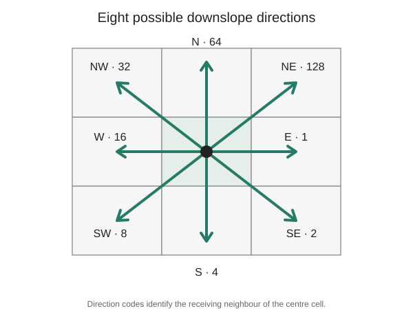

# D8 flow direction: where does each DEM cell drain?

Stable ID: `SA-RASTER-D8-FLOW-DIRECTION` · Draft 0.1 · Source compendium section 4, pages 6–7

## The hydrology question

A digital elevation model (DEM) stores terrain height on a grid. A flow-direction method assigns a downstream direction to each cell so that later steps can estimate flow accumulation, delineate streams or identify contributing areas.

D8 is a common single-direction method. Each cell examines its eight neighbours and chooses the one with the steepest downslope gradient.

## The slope calculation

For a centre cell with elevation $z_0$ and a candidate neighbour with elevation $z_1$, the drop is $z_0-z_1$. The horizontal distance depends on the cell dimensions and neighbour offset:

$$
d=\sqrt{(\Delta r\,s_r)^2+(\Delta c\,s_c)^2}
$$

The candidate slope is:

$$
s=\frac{z_0-z_1}{d}.
$$

Only positive slopes are eligible. The neighbour with the greatest positive slope is selected.

## Direction codes

The implementation uses the common ESRI power-of-two convention, with rows increasing southward and columns increasing eastward:

| Direction | Code |
|---|---:|
| E | 1 |
| SE | 2 |
| S | 4 |
| SW | 8 |
| W | 16 |
| NW | 32 |
| N | 64 |
| NE | 128 |

A valid cell with no lower valid neighbour receives 0 in this teaching implementation. NoData or invalid cells receive -1.

*The code points to the receiving neighbour; zero is reserved for a sink or unresolved flat in this implementation.*

## Why cell dimensions matter

For rectangular cells, diagonal distances are not $\sqrt{2}$ times a single cell size. Use separate row and column spacing and make sure horizontal and vertical units are compatible. If the DEM elevation units differ from the horizontal units, convert them before comparing slopes.

## Flat areas, pits and DEM conditioning

The simple strict-descent rule does not resolve flats or fill depressions. A pit therefore remains a sink, and a flat cell with no strictly lower neighbour receives code 0. Production hydrology often applies a conditioning method such as priority-flood depression filling or flat resolution before flow routing. Those operations change the surface and must be recorded.

## Teaching implementation

The [Python implementation](../../implementations/python/d8-flow/README.md) calculates D8 direction on a small 2D grid, accepts non-square cell spacing and supports an explicit validity mask or NoData sentinel. It does not calculate flow accumulation, stream networks, watershed boundaries, or D-infinity and multiple-flow-direction outputs.

## Exercises

1. Predict the direction codes for a plane sloping east.
2. Create a cell where the largest elevation drop is not the steepest slope because one candidate is diagonal.
3. Change the cell dimensions and see whether the selected direction changes.
4. Create a pit and a flat. Why do both receive code 0 in this baseline?
5. Explain why a real DEM workflow needs a declared depression and flat-resolution policy.

## References

- O'Callaghan, J. F. and Mark, D. M. (1984), “The extraction of drainage networks from digital elevation data,” *Computer Vision, Graphics, and Image Processing*, 28(3), 323–344. https://doi.org/10.1016/S0734-189X(84)80011-0.
- Jenson, S. K. and Domingue, J. O. (1988), “Extracting topographic structure from digital elevation data for geographic information system analysis,” *Photogrammetric Engineering & Remote Sensing*, 54(11), 1593–1600. [USGS publication record](https://pubs.usgs.gov/publication/70142175).

**Scope:** single-direction D8 steepest-descent assignment on a 2D raster; no depression filling, flat resolution, accumulation or watershed delineation is implemented.
