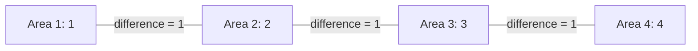

# Geary's C: how different are neighbouring values?

Stable ID: `SA-STAT-GLOBAL-GEARY-C` · Draft 0.1 · Source compendium section 2

## Start with the difference between neighbours

Imagine a map of average travel times by neighbourhood. One area has a value of 18 minutes. Its neighbour has 19. Another neighbour has 42.

Geary's C looks directly at differences between connected places. Instead of comparing each value with the overall mean first, it asks how far apart neighbouring values are.

**Global Geary's C measures the overall difference between neighbouring observations, relative to the variation in the full dataset.**

It is a global statistic: one number summarises the whole study area. It does not identify the particular neighbourhoods that form clusters or outliers.

## The question it answers

Given:
- one continuous value for each of $n$ spatial units;
- a spatial weights matrix $W$ describing which units are neighbours and how strongly they are connected;

Geary's C measures whether connected units tend to have similar or dissimilar values.

The definition of a neighbour is a modelling decision. Shared boundaries, distance bands and nearest-neighbour graphs describe different relationships. The same values can produce different statistics under different weights.

## The simple idea

For every connected pair, calculate the difference between their values and square it.

- Small differences between neighbours contribute little to the numerator.
- Large differences contribute much more because the difference is squared.
- The denominator measures the overall variation in the dataset.
- The weights determine how much each pair contributes.

The squared difference means Geary's C is especially responsive to sharp contrasts between neighbouring observations. Moran's I, by comparison, uses cross-products of deviations from the global mean. The two statistics are complementary, not interchangeable.

## The formula

Let $x_i$ be the value at location $i$, and let $\bar{x}$ be the mean across all $n$ locations. Let $w_{ij}$ be the spatial weight from location $i$ to location $j$. The sum of all weights is:

$$
S_0 = \sum_{i=1}^{n}\sum_{j=1}^{n} w_{ij}
$$

Global Geary's C is:

$$
C = \frac{n-1}{2S_0}
\frac{\sum_{i=1}^{n}\sum_{j=1}^{n}w_{ij}(x_i-x_j)^2}
{\sum_{i=1}^{n}(x_i-\bar{x})^2}
$$

The numerator adds the weighted squared differences across connected pairs. The denominator scales those differences against the total variation in the data.

Under the usual randomisation null hypothesis, the expected value is:

$$
E[C] = 1
$$

Interpretation:

| Result | What it suggests |
|---|---|
| $C<1$ | Neighbours tend to have more similar values than expected under the null |
| $C \approx 1$ | The overall neighbour differences are around the null expectation |
| $C>1$ | Neighbours tend to have more dissimilar values than expected under the null |

These are directions of association, not significance statements. A statistic near 1 is not proof that the data are random; inference requires a reference distribution.

## See the neighbourhood comparison

The graph below uses the same four-area chain as the Moran's I lesson. Each edge contributes a squared difference. In this simple graph, each undirected connection appears twice in the directed matrix sum: once as $w_{ij}$ and once as $w_{ji}$.



With values $x=[1,2,3,4]$, each connected pair differs by one. If we change the values to $x=[1,4,1,4]$, every connected pair differs by three. The neighbourhood graph stays the same, but the squared differences become nine times larger.

## Work through the calculation

Use binary, symmetric weights for the four-area chain:

$$
W =
\begin{bmatrix}
0&1&0&0\\
1&0&1&0\\
0&1&0&1\\
0&0&1&0
\end{bmatrix}
$$

For $x=[1,2,3,4]$:

- $n=4$
- $\bar{x}=2.5$
- $S_0=6$
- $\sum_i\sum_j w_{ij}(x_i-x_j)^2=6$
- $\sum_i(x_i-\bar{x})^2=5$

So:

$$
C = \frac{4-1}{2\times6}\times\frac{6}{5}
= 0.3
$$

Because $C$ is below one, neighbouring values are more similar than expected under the randomisation reference.

For the alternating values $x=[1,4,1,4]$:

- each of the three undirected edges has a difference of three;
- each directed edge contributes $3^2=9$;
- the directed numerator is $54$;
- the denominator is $9$.

Therefore:

$$
C = \frac{3}{12}\times\frac{54}{9}
= 1.5
$$

The statistic is above one: neighbours are dissimilar in this example.

## Geary's C and Moran's I side by side

Both statistics use the same spatial units and weights, but they measure similarity differently.

| | Moran's I | Geary's C |
|---|---|---|
| What it compares | Deviations from the overall mean | Differences between neighbouring values |
| Main mathematical term | $z_i z_j$ | $(x_i-x_j)^2$ |
| Null expectation | $-1/(n-1)$ | $1$ |
| Positive spatial autocorrelation | $I>E[I]$ | $C<1$ |
| Negative spatial autocorrelation | $I<E[I]$ | $C>1$ |
| Useful emphasis | Overall spatial association | Pairwise contrasts between neighbours |

Do not assume that one statistic can be converted directly into the other. Their values, distributions and inference procedures are different.

## How to assess significance

The observed value alone does not tell us whether the pattern is statistically unusual.

A common approach is permutation inference:

1. Calculate the observed Geary's C using the observed values and fixed weights.
2. Shuffle the values across spatial units while keeping the weights matrix fixed.
3. Recalculate Geary's C for each shuffled arrangement.
4. Repeat for the chosen number of permutations.
5. Compare the observed statistic with the simulated reference distribution.

The expected value of the permutation distribution is one under the randomisation null. For Geary's C, values in the lower tail indicate stronger positive autocorrelation; values in the upper tail indicate stronger negative autocorrelation. Use the inference procedure and sidedness documented by the software version you run. Do not assume that a software package's reported pseudo-$p$-value is a generic two-sided test.

The official PySAL guide demonstrates analytical and permutation-based inference and reports the statistic, expected value and simulated reference distribution. Its API documentation should be consulted for the exact output and options in the installed version.

## A reproducible PySAL workflow

For polygon data in a GeoDataFrame, the current PySAL guide demonstrates this pattern:

```python
import numpy as np
from libpysal import graph
from esda import Geary

# Keep the GeoDataFrame and attribute in exactly the same row order.
y = gdf["value"].to_numpy()
w = graph.Graph.build_contiguity(gdf, rook=False).transform("r")

np.random.seed(12345)
result = Geary(y, w, permutations=999)

print("Observed C:", result.C)
print("Expected C:", result.EC)
print("Permutation p-value:", result.p_sim)
```

Here `rook=False` constructs Queen contiguity and `transform("r")` row-standardises the weights. Those are explicit modelling choices, not universal defaults. The random seed is set to make the example reproducible; follow the installed PySAL version's guidance for reproducible permutation inference.

## Try it yourself

- Change the values from $x=[1,2,3,4]$ to $x=[1,4,1,4]$. Explain why Geary's C moves from below one to above one.
- Add a fifth unit with no neighbours. How does the weights matrix represent it, and what does your software do with it?
- Compare binary and row-standardised weights. Does the statistic change for your graph? Why?
- Use a real polygon dataset and compare Queen with Rook contiguity.
- Calculate Moran's I and Geary's C for the same attribute and weights. Explain why their directions can agree while their numerical values cannot be compared directly.
- Run a permutation test with a fixed seed. Inspect the simulated distribution rather than reporting only a p-value.

## Python implementation and notebook

- [Interactive Geary's C notebook](../../notebooks/gearys-c-lab.ipynb)
- [Python implementation](../../implementations/python/geary-c/README.md)
- [Step-by-step implementation walkthrough](../../implementations/python/geary-c/implementation-walkthrough.md)
- [Implementation source](../../implementations/python/geary-c/geary_c.py)
- [Tests](../../implementations/python/geary-c/test_geary_c.py)

The reference implementation calculates the statistic only. It does not calculate analytical or permutation-based significance. It uses a dense matrix and is intended for learning, not large spatial graphs.

## What to keep in the analysis record

Always report:
- the spatial units and measured variable;
- the spatial weights construction and transformation;
- whether the weights are symmetric or directed;
- how islands, missing values and disconnected units were handled;
- the inference method, permutation count, random seed and test interpretation;
- the spatial scale and any alternative weights definitions considered.

## References

- PySAL `esda`. [Global Spatial Autocorrelation with Geary's C](https://pysal.org/esda/stable/user-guide/geary.html). The formula, interpretation and inference discussion in this lesson are paraphrased from this official guide.
- PySAL `esda`. [Geary API reference](https://pysal.org/esda/v2.9.0/source/generated/esda.Geary.html). Check the current stable API for the version you install.
- Cliff, A. D., and Ord, J. K. (1981). *Spatial Processes: Models & Applications*. Pion.

## What this lesson does not claim

- Geary's C does not identify the locations of clusters; local statistics answer a different question.
- $C<1$ or $C>1$ is not, by itself, a significance result.
- There is no universal best spatial weights matrix.
- The dense Python implementation is not a replacement for tested spatial statistics software.

## Change history

| Version | Date | Change |
|---|---|---|
| 0.1 | 2026-11-13 | Initial reader-facing research draft and tested dense reference implementation |
