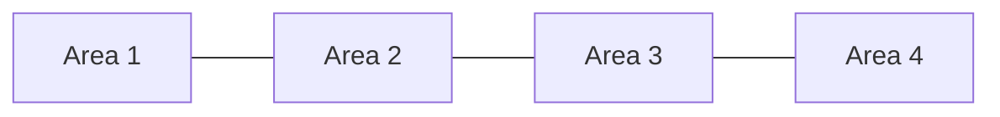

# Moran's I: do similar values sit near one another?

<text>Stable ID: `SA-STAT-GLOBAL-MORANS-I` · Draft 0.1 · Source compendium section 2, pages 2–3</text>

## 1. Start here

Imagine a map showing the average rent in each neighbourhood. Are expensive neighbourhoods usually next to other expensive neighbourhoods? Do lower values tend to sit together? Or are high and low values mixed across the map?

A map can suggest an answer, but Moran's I gives us a way to measure the overall pattern.

**Global Moran's I asks whether places with similar values tend to be neighbours, given a spatial weights matrix that defines what “neighbour” means.**

## 2. The problem

A dataset gives us:
- a value for each of (n) spatial units, such as a district, census area or grid cell;
- a definition of which units are connected or considered close to one another.

The second part matters as much as the first. Sharing a boundary, falling within a distance band and being among the (k) nearest neighbours are different definitions of spatial relationship. They can produce different results.

Moran's I is a **global statistic**: it summarises the overall relationship in one number. It does not tell us where individual clusters or outliers are located.

## 3. The simple idea

For each area, compare its value with the values in its neighbourhood.

- If high values tend to sit beside high values, and low beside low, the overall association is positive.
- If high values tend to sit beside low values, the association is negative.
- If the arrangement is no more patterned than the chosen null model would suggest, the statistic will be near its expected value under that null.

The spatial weights matrix (W) records the neighbourhood relationships. The value (w_{ij}) describes the weight assigned from unit (i) to unit (j). A zero means that the pair does not contribute to the neighbourhood comparison.

## 4. In one minute

Let (x_i) be the observed value for unit (i), and let (z_i=x_i-ar{x}) be its deviation from the overall mean. Let (S_0) be the sum of all weights:

$$
S_0 = \sum_{i=1}^{n}\sum_{j=1}^{n} w_{ij}
$$

Global Moran's I is:

$$
I = \frac{n}{S_0}
\frac{\sum_{i=1}^{n}\sum_{j=1}^{n}w_{ij}z_i z_j}
{\sum_{i=1}^{n}z_i^2}
$$

In plain language, the numerator compares each area's deviation with the deviations of its neighbours. The denominator scales that comparison by the overall variation in the data.

Under the usual randomisation reference, the expected value is:

$$
E[I] = -\frac{1}{n-1}
$$

That is slightly below zero for a finite number of spatial units. So “zero means random” is a useful large-sample shortcut, but it is not the exact expected value for a finite sample.

## 5. What counts as a neighbour?

A spatial weights matrix turns a map into a mathematical relationship.

Common choices include:

| Weights | What it means | Important detail |
|---|---|---|
| Rook contiguity | Two polygons share an edge | A shared corner alone does not count |
| Queen contiguity | Two polygons share an edge or vertex | Usually creates at least as many links as rook contiguity |
| Distance band | Units within a chosen distance are neighbours | The distance and coordinate units must be appropriate |
| k-nearest neighbours | Each unit is linked to its (k) nearest units | Can create asymmetric relationships before symmetrisation |

A common transformation is row standardisation: divide each nonzero row by its row sum so that its weights sum to one. This makes the spatial lag a weighted neighbourhood average. It also changes the statistic, so record the transformation used.

Some units may have no neighbours. These are often called *islands*. A row-standardisation procedure cannot create neighbours that do not exist; an island remains a zero row and needs to be reported.

### A tiny neighbourhood graph

Here four units form a simple chain. Only adjacent units are connected.

With values (1,2,3,4), adjacent values are similar. With values (1,4,1,4), adjacent values alternate. The geography is unchanged; only the values have changed.

## 6. Work through a small example

Use the four-unit chain above with binary, symmetric weights:

$$
W =
\begin{bmatrix}
0&1&0&0\\
1&0&1&0\\
0&1&0&1\\
0&0&1&0
\end{bmatrix}
$$

For (x=[1,2,3,4]):

- (n=4)
- (ar{x}=2.5)
- (z=[-1.5,-0.5,0.5,1.5])
- (S_0=6)
- (sum_i\sum_j w_{ij}z_i z_j=2.5)
- (sum_i z_i^2=5)

Therefore:

$$
I = \frac{4}{6}\times\frac{2.5}{5}
= \frac{1}{3}
\approx 0.333
$$

The statistic is positive: neighbouring values tend to be similar in this example.

Now change the values to ([1,4,1,4]), keeping exactly the same weights. The result is (-1): each unit is next to units with the opposite value.

These are demonstrations of the statistic, not significance tests. We have not yet compared either value with a reference distribution.

## 7. The spatial lag and Moran scatterplot

The spatial lag of the centred values is:

$$
(Wz)_i = \sum_{j=1}^{n}w_{ij}z_j
$$

It summarises the values around each unit according to the chosen weights. A Moran scatterplot places each unit's standardised value on one axis and its spatial lag on the other.

The slope of the fitted line is global Moran's I under the corresponding standardisation. The plot helps explain the statistic, but it does not replace the inference step.

## 8. How to assess statistical significance

A value of (I) by itself does not tell us whether the observed pattern is unusual. We need a reference distribution under a stated null hypothesis.

A common approach is a permutation test:

1. Calculate (I_{obs}) from the observed values and fixed weights.
2. Shuffle the observed values across the spatial units, keeping (W) fixed.
3. Recalculate Moran's I for the shuffled values.
4. Repeat this (M) times.
5. Compare the observed statistic with the simulated distribution.

For a pre-specified one-sided test for positive spatial autocorrelation, a common pseudo-(p)-value is:

$$
p = \frac{C+1}{M+1}
$$

Here (C) is the number of simulated statistics at least as large as the observed statistic. The added one prevents a zero pseudo-(p)-value. With (M=999), the smallest attainable value is (0.001).

Choose the alternative hypothesis before running the test. A right-tailed test for clustering, a left-tailed test for dispersion and a two-tailed test answer different questions.

Analytical normality and randomisation-based inference are also available. Their variance assumptions differ, and analytical approximations can be unreliable for small samples or highly irregular weights. The PySAL guide explains both approaches and their limitations.

## 9. What the result can and cannot tell you

A positive and statistically significant result supports evidence of positive global spatial autocorrelation under the selected weights and null model. It does not prove that a particular process caused the pattern.

It also does not locate the clusters. A single global value can hide local differences—for example, high-high clusters in one part of a city and low-low clusters elsewhere. Local Moran statistics and other local methods address different questions and deserve separate lessons.

Do not interpret the statistic without reporting:
- the spatial units and attribute;
- how the weights were constructed;
- the weights transformation;
- how islands and missing observations were handled;
- the inference method, number of permutations and test sidedness;
- the study area's scale and the effect of alternative spatial units.

## 10. A small Python implementation

The accompanying reference implementation calculates the statistic from a dense weights matrix and includes a row-standardisation helper. It deliberately does not calculate analytical or permutation (p)-values.

- [Python implementation and walkthrough](../../implementations/python/global-morans-i/README.md)
- [Implementation source](../../implementations/python/global-morans-i/moran_i.py)
- [Tests](../../implementations/python/global-morans-i/test_moran_i.py)

For production analysis and inference, use a maintained spatial statistics library. The [PySAL `esda` guide](https://pysal.org/esda/stable/user-guide/global_morans_i.html) demonstrates weights construction, spatial lags, global Moran's I, scatterplots and permutation inference.

## 11. Complexity and implementation limits

The teaching implementation uses a dense (n\times n) matrix.

- **Time:** (O(n^2)) for the direct double sum.
- **Weight storage:** (O(n^2)) for the dense matrix.
- **Sparse implementations:** can work in proportion to the number of nonzero weights, often written (O(m)) for the statistic once the weights are stored.

The dense implementation is intended for learning and small examples. It is not the right tool for a very large sparse spatial graph.

## 12. Have a go

1. Change ([1,2,3,4]) to ([1,4,1,4]). Explain why the sign changes.
2. Row-standardise the chain weights. Why does the numerical value change?
3. Add an isolated fifth unit. What happens to the weights row and what should be reported?
4. Replace the chain with a ring where the first and last units are also neighbours. Recalculate the statistic.
5. Compare rook and queen contiguity on a polygon dataset. Explain how the neighbour graph changes before interpreting the new statistic.
6. Run a permutation test with a fixed random seed. Explain what the pseudo-(p)-value means and what it does not mean.

## 13. References and further reading

- Moran, P. A. P. (1950). “Notes on Continuous Stochastic Phenomena.” *Biometrika*, 37(1/2), 17–23. [https://doi.org/10.1093/biomet/37.1-2.17](https://doi.org/10.1093/biomet/37.1-2.17)
- PySAL `esda`. [Global Spatial Autocorrelation with Moran's I](https://pysal.org/esda/stable/user-guide/global_morans_i.html).
- PySAL `esda`. [`esda.Moran` API reference](https://pysal.org/esda/dev/generated/esda.Moran.html).
- PySAL `libpysal`. [Queen contiguity weights](https://pysal.org/libpysal/stable/generated/libpysal.weights.Queen.html).

## 14. What remains uncertain

- The best weights definition is a substantive modelling decision, not a universal default.
- Analytical inference depends on assumptions about sampling and the weights structure.
- Permutation inference still depends on the null model and the exchangeability of values across the chosen units.
- The pure Python example is a transparent implementation of the statistic, not a substitute for a complete spatial inference package.

## Change history

| Version | Date | Change |
|---|---|---|
| 0.1 | 2026-11-13 | Initial reader-facing research draft and tested dense reference implementation |
