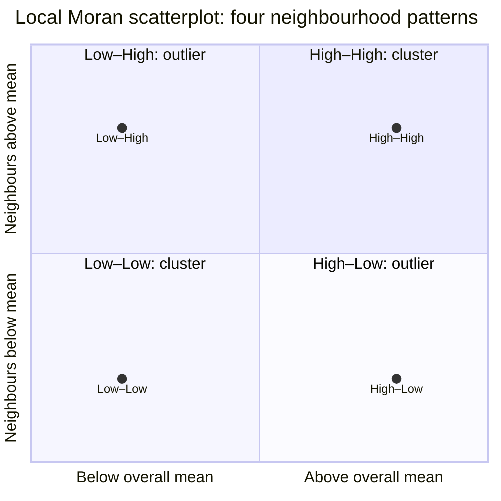

# Local Moran's I: where are the clusters and outliers?

Stable ID: `SA-STAT-LOCAL-MORANS-I` · Draft 0.1 · Source compendium section 2

## Start with the question a global statistic cannot answer

A global statistic can tell you that a map has an overall spatial pattern. But it cannot tell you which neighbourhoods are contributing to that pattern.

Imagine a city where house prices are high in one part, low in another, and a few neighbourhoods break the pattern. A single number can summarise the whole city, but it cannot show you where those clusters and exceptions occur.

**Local Moran's I gives each spatial unit its own statistic, helping us find clusters of similar values and spatial outliers.**

It is commonly used as a Local Indicator of Spatial Association (LISA). It is a diagnostic, not a causal explanation.

## What each area is compared with

For each unit, Local Moran's I considers two things:

1. How far the unit's value is above or below the overall mean.
2. How far the values in its neighbourhood are above or below the overall mean.

The first is the unit's standardised value. The second is its spatial lag: a weighted summary of neighbouring values.

The relationship is commonly expressed as:

$$
I_i = \frac{n-1}{\sum_{k=1}^{n}z_k^2} z_i\sum_{j=1}^{n}w_{ij}z_j
$$

where:
- $z_i$ is the standardised value at location $i$;
- $w_{ij}$ is the spatial weight from location $i$ to location $j$;
- the weighted sum is the spatial lag of the standardised values.

This is the standardised form used by PySAL's `Moran_Local`: the input is transformed to have zero mean and unit standard deviation, and the factor $(n-1)/\\sum_k z_k^2$ is applied. Since the squared standardised values sum to $n$, this factor is $(n-1)/n$. Other presentations of local Moran statistics may use a different scaling convention. Always identify the convention and implementation used.

## Four local patterns

The Moran scatterplot places a unit's standardised value on the horizontal axis and its spatial lag on the vertical axis. The sign of each tells us which quadrant the unit falls into.

<text>Original teaching diagram: the four quadrants below are a project-created schematic. The cluster labels follow the PySAL default quadrant convention.</text>



| Pattern | The unit | Its neighbours | Common interpretation |
|---|---|---|---|
| High–High (HH) | Above the mean | Mostly above the mean | High-value cluster |
| Low–Low (LL) | Below the mean | Mostly below the mean | Low-value cluster |
| High–Low (HL) | Above the mean | Mostly below the mean | High-value spatial outlier |
| Low–High (LH) | Below the mean | Mostly above the mean | Low-value spatial outlier |

The labels describe a relationship, not a judgement. “High” and “low” are relative to the study area's attribute distribution, not absolute measures of good or bad.

### A note about quadrant codes

PySAL's default `geoda_quads=False` uses these codes:

| Code | PySAL default |
|---:|---|
| 1 | High–High |
| 2 | Low–High |
| 3 | Low–Low |
| 4 | High–Low |

Setting `geoda_quads=True` changes the coding to match GeoDa's convention. The labels remain the same, but the numbers for LH and HL swap. Do not assume quadrant codes are universal across software.

## A cluster is not automatically significant

A quadrant tells you the direction of the local relationship. It does not tell you whether that pattern is statistically unusual.

Local Moran analysis normally calculates a reference distribution for each unit using conditional permutations:

1. Select one unit.
2. Keep that unit's observed value fixed.
3. Shuffle the values among the other units.
4. Recalculate the local statistic for the selected unit.
5. Repeat for the chosen number of permutations.
6. Compare the observed statistic with its simulated reference distribution.

The value at the focal unit stays fixed because it is part of the local statistic being tested. This is different from the global permutation procedure, which shuffles the full set of values across all locations.

For reproducibility, set the random seed in the Local Moran constructor itself. The current PySAL documentation notes that seeding outside the constructor does not reliably control the conditional randomisation implementation.

## Why multiple testing matters

A local analysis runs one test for every spatial unit. If a map has 500 neighbourhoods, it produces 500 local tests.

At a nominal significance level of 0.05, some results may appear significant by chance even when there is no local pattern. The tests are also spatially dependent: neighbouring units share observations in their calculations.

For that reason:
- report how many local tests were run;
- state the significance threshold and permutation procedure;
- consider a multiple-testing correction;
- do not map every unadjusted result as a confirmed cluster;
- interpret the local results alongside the global pattern and the chosen weights.

PySAL provides `esda.fdr`, which calculates a p-value cutoff for false-discovery-rate control. It returns a threshold, not a new adjusted p-value for every unit. Apply the cutoff to the local p-values and document the procedure.

## Local Moran is not the same as a hotspot test

Local Moran's I identifies four kinds of local relationship: HH, LL, HL and LH. That includes both clusters and spatial outliers.

Getis-Ord Gi* is designed to identify local concentrations of high or low values. It does not identify high-low or low-high spatial outliers in the same way.

Use the method that matches the question:
- “Where are similar values clustered, and where do local exceptions occur?” — Local Moran's I.
- “Where are high or low values concentrated?” — Getis-Ord Gi*.
- “Where do sharp differences occur between neighbours?” — Local Geary.

These methods can complement one another, but their statistics and inference are not interchangeable.

## Work through it with PySAL

The accompanying notebook uses a small synthetic ring graph. It is deliberately not a geographic map: the example isolates the statistical relationships before introducing polygon geometry and real data.

The notebook:
- builds a spatial weights object;
- calculates local Moran statistics with conditional permutations;
- shows the four quadrants in a scatterplot;
- compares raw local p-values with an FDR threshold;
- lets you change the values and see how the local pattern responds.

- [Interactive Local Moran's I notebook](../../notebooks/local-morans-i-lab.ipynb)

For a real polygon dataset, the official PySAL guide demonstrates how to construct Queen contiguity weights, calculate local statistics, inspect the scatterplot and produce a cluster map.

## Reproducible PySAL example

```python
from libpysal import graph
from esda.moran import Moran_Local
from esda import fdr

# Keep the GeoDataFrame and attribute in exactly the same row order.
y = gdf["value"].to_numpy()
w = graph.Graph.build_contiguity(gdf, rook=False).transform("r")

local = Moran_Local(
    y,
    w,
    transformation="r",
    permutations=999,
    seed=12345,
    alternative="two-sided",
)

# The default PySAL quadrant codes are 1=HH, 2=LH, 3=LL, 4=HL.
fdr_cutoff = fdr(local.p_sim, alpha=0.05)
significant_after_fdr = local.p_sim <= fdr_cutoff
```

The example uses Queen contiguity, row-standardised weights and a two-sided conditional permutation test. Those are explicit choices for this example, not universal defaults.

## What to report

A useful local analysis record includes:
- the spatial units, attribute and study area;
- the weights definition, transformation and treatment of islands;
- the Local Moran implementation and quadrant convention;
- the number of conditional permutations and random seed;
- the alternative hypothesis and p-value interpretation;
- the multiple-testing correction and threshold;
- the global statistic used as context;
- the limitations of the data and spatial scale.

## References

- Anselin, L. (1995). “Local Indicators of Spatial Association—LISA.” *Geographical Analysis*, 27(2), 93–115. [https://doi.org/10.1111/j.1538-4632.1995.tb00338.x](https://doi.org/10.1111/j.1538-4632.1995.tb00338.x)
- PySAL `esda`. [Local Spatial Autocorrelation with Moran's I](https://pysal.org/esda/stable/user-guide/local_spatial_autocorrelation.html).
- PySAL `esda`. [Moran_Local API reference](https://pysal.org/esda/stable/generated/esda.Moran_Local.html).
- PySAL `esda`. [False-discovery-rate cutoff](https://pysal.org/esda/stable/generated/esda.fdr.html).

## What this lesson does not claim

- A quadrant label alone does not establish statistical significance.
- A significant local statistic does not identify a causal mechanism.
- Local tests are not independent of one another.
- The best weights definition depends on the substantive question.
- A local Moran cluster is not the same thing as a Getis-Ord hotspot.

## Change history

| Version | Date | Change |
|---|---|---|
| 0.1 | 2026-11-13 | Initial reader-facing research draft, with official PySAL workflow and interactive notebook |
