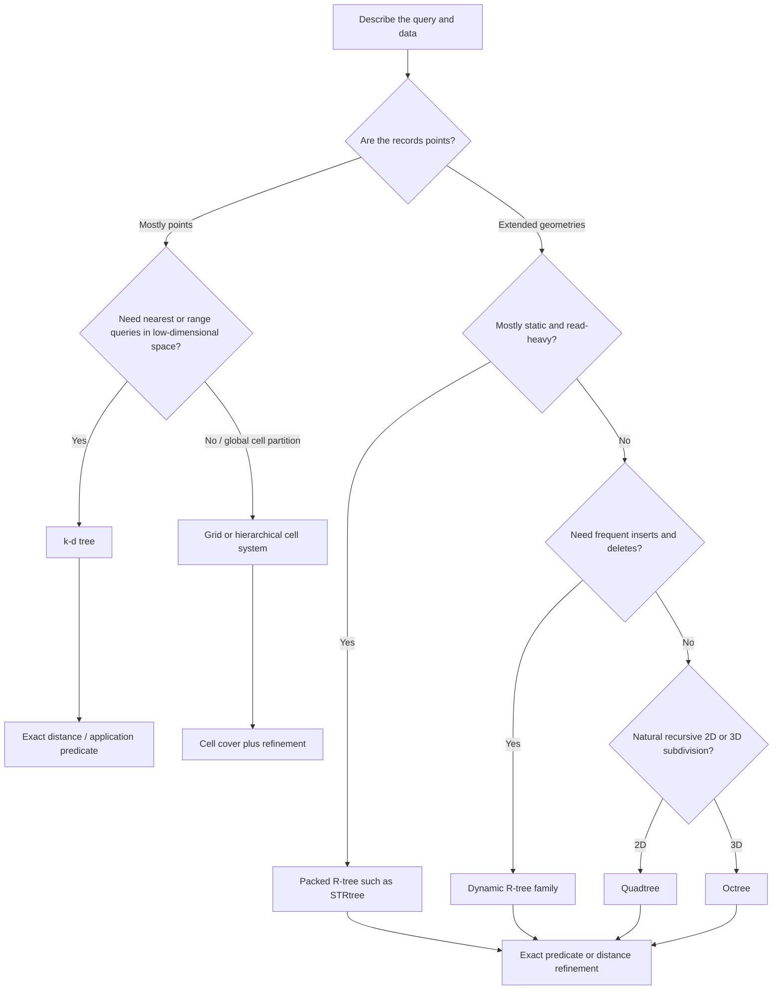

# Choosing a spatial index: start with the query, not the data structure

A spatial index helps a computer avoid checking every object for every query. The right choice depends less on which structure sounds most sophisticated and more on what is stored, what questions are asked, how often the data changes and how the data is distributed.

This guide is a decision aid, not a universal performance ranking. Two indexes with the same name can behave differently because of implementation details, node capacity, update strategy and workload.

## First, what does the query need?

A spatial index is usually a **candidate finder**. It narrows the objects that might match. An exact geometry predicate or distance calculation then decides which candidates really match.

For example, a polygon's bounding box can overlap a query window even when the polygon itself does not. That is a false positive from the index, not a wrong final answer. Keep the filter and exact-refinement steps distinct.

## A practical decision route

This is a starting point. Real workloads may justify a different choice after measurement.

## Compare the main options

| Structure | What it organises | A good starting fit | Watch out for |
|---|---|---|---|
| **R-tree** | Bounding rectangles around objects, grouped hierarchically | Points, lines, polygons and other objects with spatial extent; range and intersection candidate queries | Overlapping node rectangles can force many branches to be visited; loose object envelopes create false positives |
| **STR-packed R-tree** | A static R-tree built by Sort-Tile-Recursive packing | Read-heavy data loaded in batches; repeat queries against an unchanged collection | It is not a dynamic index: rebuild when the indexed collection changes |
| **Quadtree** | Recursive subdivision of 2D space into four quadrants | 2D point sets, spatial partitioning, adaptive detail and some raster/tile workflows | Dense clusters can cause deep subdivision; extended objects may occupy multiple cells or need separate handling |
| **k-d tree** | Points split by alternating or selected coordinate axes | Low-dimensional point data; range and nearest-neighbour queries in Euclidean space | Performance can degrade with poor balance, unfavourable distributions or higher dimensions; it is not a general extended-geometry index |
| **Grid / spatial hash** | Space divided into fixed-size cells | Uniform or predictable workloads; fast cell lookup, simulation and broad-phase collision detection | Cell size is workload-sensitive; large objects span many cells and dense cells become expensive |
| **Octree** | Recursive subdivision of 3D space into eight octants | 3D point clouds, volumes and spatial hierarchies | Memory and traversal costs depend on depth and occupancy; choose a clear stopping rule |
| **H3, S2, Geohash and related cell systems** | Locations mapped to hierarchical or fixed-resolution cells | Global partitioning, aggregation, distributed processing and approximate neighbourhood discovery | A cell cover is not an exact geometry predicate; boundary effects and resolution choices require refinement |

## Match the index to the workload

### 1. You store polygons, roads, buildings or other extended geometries

Start by evaluating an R-tree. It indexes object envelopes, allowing a query to skip groups whose bounding rectangles cannot match.

For a static collection that is loaded once and queried repeatedly, a packed R-tree such as STRtree is a natural candidate. Shapely's STRtree is query-only, indexes two-dimensional axis-aligned bounding boxes and returns positions corresponding to the input geometry sequence. It does not support adding or removing individual geometries after construction.

For a collection that changes frequently, evaluate a dynamic R-tree implementation and its update behaviour. Do not assume that a static packed index and a dynamic tree have the same cost profile.

### 2. You store points and need nearest neighbours

A k-d tree is a reasonable candidate for low-dimensional Euclidean point data. It recursively partitions coordinate space and can prune regions that cannot contain a nearer point.

Compare it with a grid, a ball tree or brute force for the actual dimensionality, point distribution and query volume. In two dimensions, a simple grid can be competitive when points are reasonably distributed and the cell size matches the query scale. In high-dimensional feature spaces, tree pruning can become less effective.

### 3. You need a hierarchy over a 2D or 3D region

A quadtree or octree divides space recursively rather than grouping arbitrary object envelopes.

A quadtree is useful when local density or required resolution varies across a two-dimensional region. An octree applies the same idea in three dimensions and is common in point-cloud and volume workflows.

These structures are not automatically better than an R-tree for polygons. Ask whether the application benefits from space subdivision itself, or whether it mainly needs fast candidate lookup for irregular geometries.

### 4. You need global cells or distributed partitions

H3, S2 and Geohash are spatial cell systems, not drop-in replacements for exact geometry indexes.

They are useful for assigning records to cells, partitioning data, aggregating counts and finding approximate candidate neighbourhoods. A polygon may cover many cells, and a cell boundary may not match the exact geometry boundary. Use an exact geometry or distance test where the application requires one.

## Questions to answer before choosing

Record these before benchmarking:

1. **Object type:** points, rectangles, lines, polygons, meshes or mixed geometries?
2. **Query type:** point lookup, range, intersection, containment, nearest neighbour, distance-within, kNN join or repeated spatial join?
3. **Update pattern:** immutable snapshot, periodic rebuild, streaming inserts, frequent deletes or edits?
4. **Dimensionality:** 2D, 3D or higher-dimensional feature space?
5. **Distribution:** uniform, clustered, elongated, sparse, highly overlapping or strongly skewed?
6. **Geometry shape:** do bounding boxes closely fit objects, or are objects long, concave or fragmented?
7. **Precision:** is approximate candidate discovery acceptable if followed by exact refinement?
8. **Runtime constraints:** memory budget, concurrency, persistence, database integration and expected query rate?

## A small benchmark that answers the real question

Do not compare indexes using only construction time or a single query.

Use the same dataset and query set for every candidate. Include representative and difficult cases: uniform points, clustered points, long thin geometries, concave polygons, overlapping envelopes, small windows, large windows and nearest-neighbour queries if relevant.

Measure separately:

- build or load time;
- update cost, if updates are part of the workload;
- median and tail query latency;
- number of candidates returned;
- number of exact predicates evaluated;
- memory use;
- result equivalence against a brute-force baseline.

A faster candidate stage is not necessarily a faster end-to-end query if it produces many false positives. A benchmark is only meaningful when the workload and correctness check are recorded.

## Use the index already provided by your spatial stack

Before implementing a new index, check what the database or geometry library already supplies.

- GeoPandas exposes a spatial index through `GeoSeries.sindex` and uses spatial indexing internally for operations such as spatial joins, overlays and clipping where appropriate.
- Shapely exposes an STRtree for query-only indexing of geometry bounding boxes.
- A spatial database may provide a maintained index implementation and query planner integration. Prefer that integration when it fits the workload rather than exporting data into a separate custom index without a clear reason.

The exact available predicates and behaviours depend on the library and version. Check the current documentation for the environment you use.

## Related lessons

- [STR-packed R-tree](../algorithms/indexing/str-packed-rtree.md): see how a static packed tree is built and queried.
- [Filter-and-refine spatial join](../algorithms/query-processing/filter-refine-spatial-join.md): see why candidate pairs still need exact predicates.
- [Spatial indexing learning path](../learning-paths/spatial-indexing.md): follow the first two practical lessons.

## References and further reading

1. Guttman, A. (1984). “R-trees: A Dynamic Index Structure for Spatial Searching.” *Proceedings of the 1984 ACM SIGMOD International Conference on Management of Data*, 47–57. [https://doi.org/10.1145/602259.602266](https://doi.org/10.1145/602259.602266)
2. Leutenegger, S. T., Edgington, J. M., and Lopez, M. A. (1997). “STR: A Simple and Efficient Algorithm for R-Tree Packing.” *Proceedings of the 13th International Conference on Data Engineering*. [NASA technical report](https://ntrs.nasa.gov/api/citations/19970022245/downloads/19970022245.pdf)
3. Finkel, R. A., and Bentley, J. L. (1974). “Quad Trees: A Data Structure for Retrieval on Composite Keys.” *Acta Informatica*, 4, 1–9. [https://doi.org/10.1007/BF00288933](https://doi.org/10.1007/BF00288933)
4. Bentley, J. L. (1975). “Multidimensional Binary Search Trees Used for Associative Searching.” *Communications of the ACM*, 18(9), 509–517. [https://doi.org/10.1145/361002.361007](https://doi.org/10.1145/361002.361007)
5. [Shapely STRtree documentation](https://shapely.readthedocs.io/en/stable/strtree.html).
6. [GeoPandas spatial indexing guide](https://geopandas.org/en/stable/docs/user_guide/spatial_indexing.html).

## Review notes

This guide describes general structural trade-offs. It does not claim one index is fastest for every workload. The next practical extension should compare candidate counts and query time using a shared dataset, then add separate lessons for dynamic R-trees, quadtrees and k-d trees only when their implementations and assumptions have been verified.
