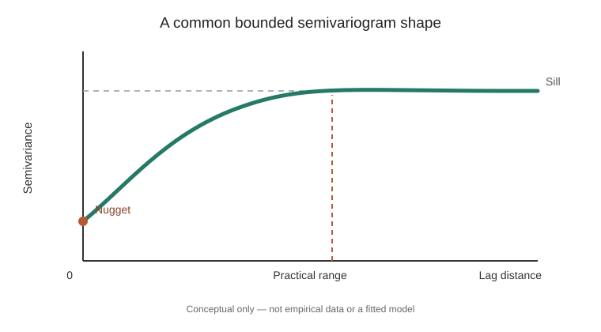

# The empirical semivariogram: how differences change with distance

- **Stable ID:** `SA-GEOSTATISTICS-EMPIRICAL-SEMIVARIOGRAM`
- **Kind:** method
- **Domain:** geostatistics
- **Status:** researched; implemented and tested within the shared geostatistics package; independent review pending
- **Version:** 0.1
- **Source inventory:** Section 3, page 4 — variogram modelling
- **Related records:** [Spatial interpolation: IDW and ordinary kriging](../algorithms/geostatistics/interpolation.md); [Spatial cross-validation](spatial-cross-validation.md)

## Are nearby measurements more alike?

Suppose you measure soil moisture, rainfall or elevation at many locations. You want to know whether observations close together tend to have similar values—and how far that relationship extends.

A semivariogram helps answer that. It compares pairs of observations and asks a simple question: **as the distance between two locations grows, how different do their measured values tend to become?**

It is one of the foundations of geostatistics and an important step before fitting a kriging model.

## The simple idea

Take every pair of measured locations. Measure the distance between the two locations, then calculate half the squared difference between their values.

Pairs separated by similar distances are grouped together. For each distance group (a *lag bin*), average the half-squared differences. Plot those averages against distance.

*Conceptual diagram created for this lesson. It illustrates common features of a bounded semivariogram model; it is not an empirical result or a fitted dataset.*

## The mathematical definition

For a spatial process $Z(\mathbf{s})$, the semivariogram under intrinsic stationarity is

$$
\gamma(\mathbf{h})=
\frac{1}{2}\operatorname{E}
\left[
\left(Z(\mathbf{s}+\mathbf{h})-Z(\mathbf{s})\right)^2
\right].
$$

Here $\mathbf{s}$ is a location and $\mathbf{h}$ is a separation vector. The semivariogram describes the expected half-squared difference between values separated by that vector.

For a non-empty lag bin, the classical Matheron empirical estimator is

$$
\widehat{\gamma}_k=
\frac{1}{2|N_k|}
\sum_{(i,j)\in N_k}
\left[z(\mathbf{s}_i)-z(\mathbf{s}_j)\right]^2,
\qquad
\bar h_k=
\frac{1}{|N_k|}
\sum_{(i,j)\in N_k} d_{ij}.
$$

$N_k$ is the set of observation pairs assigned to bin $k$, and $|N_k|$ is its pair count. The mean pair distance $\bar h_k$ is the horizontal coordinate reported for a non-empty bin. In practice, exact separation vectors are rare, so distances are grouped into bins or lag classes. The repository implementation uses left-closed, right-open intervals (with the final upper edge included). For a non-empty bin, it reports the **mean observed pair distance** as the representative lag; an empty bin retains its midpoint so the gap remains visible.

## A small example

Four observations lie along a line:

| Location | Coordinate | Value |
|---|---:|---:|
| A | 0 | 1 |
| B | 1 | 2 |
| C | 2 | 4 |
| D | 3 | 7 |

For pairs one unit apart, the squared differences are $1$, $4$ and $9$. The empirical semivariance is

$$
\widehat{\gamma}(1)=
\frac{1+4+9}{2\times 3}
=\frac{14}{6}
\approx 2.33.
$$

For pairs two units apart, the squared differences are $9$ and $25$:

$$
\widehat{\gamma}(2)=
\frac{9+25}{2\times 2}
=8.5.
$$

For the single pair three units apart, the squared difference is $36$, giving a semivariance of $18$. The values rise with separation in this tiny example. That is a description of these four observations, not enough evidence to fit a reliable geostatistical model.

## Reading a semivariogram

A fitted bounded model is often described using three features:

- **Nugget:** the semivariance approached near zero separation. A non-zero nugget can reflect measurement error, microscale variation below the sampling resolution, or both.
- **Sill:** the level the model approaches at large separation. In a covariance-stationary setting, it is related to the process variance. Some valid variogram models are unbounded and have no sill.
- **Range:** the distance at which the model reaches or practically approaches its sill. For models that approach the sill asymptotically, software may report a *practical range* under a stated convention.

The terms are useful summaries, not universal properties of every variogram.

## From observations to a model

1. Check the variable, units, sampling design and coordinate reference system.
2. Decide whether a trend should be modelled or removed before examining spatial dependence.
3. Calculate pairwise separation distances and value differences.
4. Choose a maximum lag distance and bin edges.
5. Inspect the number of pairs in each bin; sparse bins are unstable.
6. Record the bin-edge convention and representative lag statistic (mean pair distance here).
6. Plot the empirical semivariogram and inspect possible directional differences.
7. Fit a permissible theoretical model appropriate to the intended use.
8. Check the fitted model, residual behaviour and predictive performance.

The empirical points are estimates, not a smooth curve. The fitted model is a separate modelling decision.

## Direction matters

An omnidirectional semivariogram groups pairs by distance alone. If spatial dependence differs by direction, directional semivariograms can reveal anisotropy.

Geometric anisotropy can often be represented by transforming directions or distances before fitting a model. Zonal anisotropy is more complicated: the sill itself may differ by direction. Do not assume a single isotropic curve is adequate just because it is easy to calculate.

## Choices that can change the result

| Choice | Why it matters |
|---|---|
| Maximum lag distance | Controls which pairs contribute; distant pairs may be sparse or uninformative |
| Bin width and bin origin | Changes which pairs are averaged together |
| Number of pairs per bin | A bin based on few pairs is noisy |
| Trend treatment | A broad trend can make differences grow with distance even when the residual dependence has a different structure |
| Sampling geometry | Clustered or irregular samples affect which pairs are represented |
| Direction and tolerance | Directional bins may expose anisotropy, but too few pairs make them unstable |
| Estimator | Matheron's estimator is sensitive to extreme squared differences; robust alternatives make different trade-offs |
| Duplicate coordinates | Zero-distance pairs may reveal replicate variation, data errors or microscale effects |

## Computational cost

The teaching implementation visits every unordered pair of observations. For $n$ locations, it performs $n(n-1)/2$ distance calculations and uses binary search to assign each pair to one of $B$ bins. Its time complexity is $O(n^2\log(B+1)+B)$ and its auxiliary memory is $O(B)$: it accumulates distance sums, squared-difference sums and pair counts without retaining every pair. Large datasets still need pair subsampling, spatial indexing or specialised algorithms; changing the sampling design can change the empirical estimate.

## What this record calculates

The shared [geostatistics package](../implementations/python/geostatistics/README.md) exposes `empirical_variogram(samples, bin_edges)`. It computes the omnidirectional Matheron estimator from planar Euclidean distances and caller-supplied lag edges. For non-empty bins it returns mean pair distance, semivariance and pair count; empty bins return their midpoint, `None` and zero. Bins are left-closed/right-open except the final bin, which includes its upper edge. The implementation accumulates summaries online and uses $O(B)$ auxiliary memory. Its shared input validator rejects duplicate coordinates; replicate observations need an explicit aggregation or measurement-error policy before they are passed to this function.

It does not:
- fit a theoretical variogram;
- estimate a nugget, sill or range;
- calculate directional variograms;
- handle measurement uncertainty explicitly;
- choose a coordinate system or geodesic distance;
- decide whether intrinsic stationarity is appropriate.

## Try it

Complete the [empirical semivariogram exercise](../exercises/empirical-semivariogram.md) to calculate lag summaries by hand and verify the bin-edge contract in Python.

- **Predict:** Which lag class should have the largest semivariance in the four-point example?
- **Change:** Widen the lag bins. How do the pair counts and semivariances change?
- **Investigate:** Add an outlying observation. Which bins change most?
- **Compare:** Calculate directional semivariograms for a dataset with an obvious east-west pattern.
- **Question:** If the empirical curve keeps rising, is a bounded sill model appropriate?

## Runnable material

- [Shared Python implementation, tests and walkthrough](../implementations/python/geostatistics/README.md)
- [Interactive empirical-semivariogram binning lab](../notebooks/empirical-semivariogram-lab.ipynb)
- [Combined interpolation and semivariogram lab](../notebooks/geostatistics-interpolation-lab.ipynb)

## References

1. Matheron, G. (1963). “Principles of geostatistics.” *Economic Geology*, 58(8), 1246–1266. https://doi.org/10.2113/gsecongeo.58.8.1246. Foundational reference for the geostatistical framework.
2. Cressie, N. (1993). *Statistics for Spatial Data*, revised edition. Wiley. A standard treatment of empirical variograms and spatial statistical inference.
3. Hengl, T. (2007). *A Practical Guide to Geostatistical Mapping of Environmental Variables*. EUR 22904 EN, Joint Research Centre, Institute for Environment and Sustainability, European Commission. Luxembourg: Office for Official Publications of the European Communities, 143 pp., ISBN 978-92-79-06904-8. [Official JRC record](https://publications.jrc.ec.europa.eu/repository/handle/JRC38153) · [PDF](https://publications.jrc.ec.europa.eu/repository/bitstream/JRC38153/eur22904en.pdf). Provides an applied introduction to variograms and spatial prediction.
4. PyKrige documentation. [Variogram models](https://geostat-framework.readthedocs.io/projects/pykrige/en/stable/variogram_models.html). Documents model parameter conventions and supported functional forms in PyKrige; conventions can differ between packages.
5. SciKit-GStat documentation. [Variography](https://scikit-gstat.readthedocs.io/en/latest/userguide/variogram.html). Describes lag grouping and the Matheron estimator in a maintained Python geostatistics package.

## What remains to be checked

- Review the estimator against a second independent implementation.
- Add directional lag classes and a robust estimator as separate extensions.
- Compare binning rules on a documented real dataset.
- Build a fitted variogram lesson before treating nugget, sill and range as parameter estimates.

## Change history

| Version | Date | Change |
|---|---|---|
| 0.1 | 2026-11-13 | Initial researched explanation, implementation and interactive lab |
