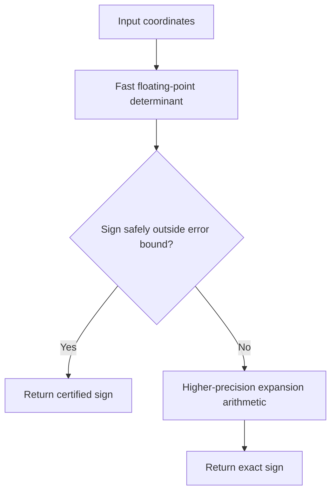

# Exact orientation predicates: make geometric decisions reliably

Computational geometry algorithms repeatedly ask small questions: is this point left or right of a directed line? Are three points collinear? Does a point lie inside a circumcircle? These are *predicates*. Their answers control the branches of larger algorithms, so one incorrect sign can corrupt a triangulation, intersection graph or polygon topology.

The 2D orientation predicate is the sign of a determinant:

[
D=(b_x-a_x)(c_y-a_y)-(b_y-a_y)(c_x-a_x).
]

- (D>0): (a,b,c) make a counter-clockwise turn.
- (D<0): clockwise turn.
- (D=0): collinear.

The difficulty is not the formula. It is deciding the sign reliably when the true determinant is very close to zero.

## 1. Why a tiny numerical error can become a topological error

Floating-point arithmetic approximates real numbers. When two large, nearly equal products are subtracted, rounding can overwhelm a small difference. The computed determinant can have the wrong sign or round to zero even when the exact determinant of the represented input coordinates is non-zero.

This is more serious than a small coordinate error. A geometric algorithm may take a different branch:

- a segment is declared to cross when it does not;
- a point is assigned to the wrong side of an edge;
- a Delaunay edge flip is made or skipped incorrectly;
- a polygon ring becomes inconsistent.

The sign is a discrete decision. A small arithmetic error can therefore cause a large structural failure.

## 2. Predicates are not constructions

A predicate answers a classification question, often with a sign or Boolean result. A construction creates a new numerical object, such as an intersection coordinate.

These are different robustness problems. A system can calculate exact predicates but still construct coordinates with ordinary floating-point arithmetic. CGAL makes this distinction explicit in its Exact Predicates Inexact Constructions Kernel and Exact Predicates Exact Constructions Kernel.

Do not assume that an exact predicate makes every coordinate produced by the algorithm exact.

## 3. A transparent exact-arithmetic baseline

The accompanying Python implementation converts each input coordinate into an exact rational representation and evaluates the determinant without floating-point arithmetic in the products or subtraction.

For Python floats, Fraction preserves the exact binary floating-point value that was supplied. It does not recover an intended decimal value that was already rounded before the function received it.

This baseline is useful for:
- validating small fixtures;
- building differential tests;
- understanding what the determinant is deciding;
- serving as a slow reference implementation.

It is not an adaptive-precision implementation and should not be used as a high-throughput geometry kernel.

## 4. Adaptive precision: fast when the sign is clear

Shewchuk's adaptive predicates use a faster approximate calculation first. An error bound determines whether the sign is certain. If the determinant is too close to zero to certify, the computation increases precision only as much as necessary.

This is the key design idea: do not pay the full exact-arithmetic cost for every easy case. The filter must be mathematically justified for the arithmetic model; an arbitrary epsilon is not a substitute for a proven error bound.

## 5. What should the tolerance be?

A common but unsafe pattern is:

[
|D|<\varepsilon \Rightarrow D=0.
]

A fixed epsilon depends on coordinate scale and units. Changing metres to millimetres can change the classification even though the geometry is identical.

A scale-aware tolerance can be appropriate for a domain-specific measurement rule, but it is not the same as an exact predicate. Keep measurement uncertainty, snapping policy and numerical robustness as separate concepts.

## 6. How to test a predicate

Use several complementary strategies:

1. **Known configurations:** clockwise, counter-clockwise and collinear triples.
2. **Translation and scale checks:** classifications should be invariant under exact translations and positive uniform scaling.
3. **Near-degenerate fixtures:** points whose determinant is tiny relative to the products being subtracted.
4. **Differential tests:** compare the fast or library predicate with an exact rational reference on generated small inputs.
5. **Metamorphic tests:** swap two points and verify the sign reverses; repeat a point and verify collinearity.

The exact reference is especially useful for finding bugs in a faster implementation. It does not prove that the faster implementation is correct for all inputs.

## 7. Further reading

- Jonathan Richard Shewchuk (1997), *Adaptive Precision Floating-Point Arithmetic and Fast Robust Geometric Predicates*, Discrete & Computational Geometry 18, 305–363. Paper and reference code: https://www.cs.cmu.edu/~quake/robust.html
- CGAL 6.2 kernel manual: https://doc.cgal.org/latest/Kernel_23/index.html
- CGAL FAQ on predicates, constructions and kernel selection: https://www.cgal.org/FAQ.html

Shewchuk's work is the primary reference for adaptive orientation and incircle predicates. The CGAL documentation is useful for understanding how exact predicates and exact constructions are separate kernel choices.

## Check your understanding

1. Why can a wrong determinant sign be more damaging than a small coordinate error?
2. What is the difference between a predicate and a construction?
3. Why is a fixed epsilon not an exact collinearity test?
4. What does the fast stage of an adaptive predicate need to prove before returning?
5. Why is exact rational arithmetic useful as a test oracle even if it is too slow for production?
6. What uncertainty remains if the input coordinates were rounded before the predicate receives them?

## Implementation and practice

- [Exact orientation implementation and tests](../implementations/python/exact-orientation/README.md)
- [Implementation walkthrough](../implementations/python/exact-orientation/implementation-walkthrough.md)
- [Exercise](../exercises/exact-orientation.md)
