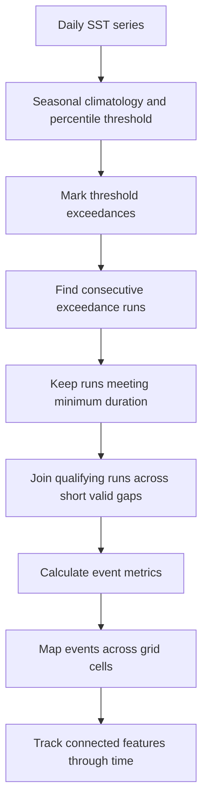

# Marine heatwave detection: turn a temperature series into events

A marine heatwave (MHW) is not simply a hot day or a fixed temperature exceedance. It is an anomalously warm, prolonged and discrete event defined relative to a seasonally varying local baseline.

Hobday et al. (2016) proposed a widely used framework: identify sea-surface temperatures above a seasonally varying 90th-percentile threshold for at least five consecutive days, then join qualifying events separated by gaps of no more than two days. The percentile is calculated relative to a baseline climatology and a moving day-of-year window. The reference period, data coverage and processing choices must be reported.

This lesson concentrates on the event-detection stage once the seasonal climatology and threshold are already available. It does not calculate the climatology from raw gridded satellite data.

## Learning objectives

- distinguish climatology, threshold exceedance and event detection;
- identify runs of consecutive threshold exceedances;
- apply a documented short-gap joining rule;
- calculate basic event duration and intensity summaries;
- explain why missing data, baseline choice and spatial support matter.

## 1. Three different quantities

For location (x) and day (t), let (T(x,t)) be observed sea-surface temperature, (C(x,d)) the seasonal climatological mean for day-of-year (d), and (Q_{0.90}(x,d)) the seasonal 90th-percentile threshold.

A threshold-exceedance day is:

[
E(x,t)=\mathbb{1}[T(x,t)>Q_{0.90}(x,d(t))].
]

An exceedance is not yet an event. A run of at least five consecutive exceedance days becomes a candidate event. Candidate events separated by at most two valid, non-exceedance days may then be joined.

Intensity is commonly described relative to the climatological mean:

[
I(x,t)=T(x,t)-C(x,d(t)).
]

The event threshold is the 90th percentile, while the intensity anomaly is measured relative to the climatological mean.

## 2. Detection sequence

The final two stages are distinct. Detecting events independently at each grid cell does not identify a single moving ocean feature. Spatial tracking needs an explicit connectivity rule, temporal overlap rule and split/merge policy.

## 3. Event metrics

For an event spanning days (t_s) through (t_e):

- **Duration:** (t_e-t_s+1) calendar days, including any joined short gap.
- **Exceedance days:** count of days above the threshold.
- **Mean intensity:** mean (T-C) over the event interval.
- **Maximum intensity:** maximum (T-C) over the event interval.
- **Cumulative intensity:** sum of daily (T-C) over the event interval, in degree-days.

The implementation returns these basic summaries. It is a teaching baseline, not a complete reproduction of every metric in the Hobday reference code.

## 4. Missing data is not a cool day

A missing observation must not be silently interpreted as a below-threshold day. The implementation treats a missing value as a hard break: it neither counts as an exceedance nor permits two events to be joined across it.

Daily sampling is assumed. If a day is absent from the input sequence, the caller must resolve the calendar gap before detection. Do not compress an irregular time series and then pretend adjacent array positions are consecutive days.

## 5. Baseline choices are part of the result

The original framework recommends a long baseline where data permit, and uses a seasonal window to estimate a day-varying mean and percentile. Satellite records, in-situ observations and changing sensors may constrain the available period. A moving contemporary baseline can answer a different question from a fixed historical baseline: extremes relative to recent conditions are not the same as extremes relative to an earlier climate.

Report at least the source product and version, units, baseline years, percentile and day-of-year pooling window, smoothing method, missing-data and quality-flag treatment, minimum duration and gap rule, and whether trends were removed or retained.

## 6. From point events to spatial features

For gridded SST, run detection at each valid grid cell. At each day, label connected exceedance cells using a declared neighbourhood (4- or 8-connectivity on a regular grid, or a suitable mesh adjacency). Then decide how to link features across days.

A tracking method must state how it handles splits, merges, intermittent missing observations, coastlines and masked land, periodic longitude boundaries, and changing feature area and intensity.

A connected-component label is a spatial snapshot, not a track. Tracking is a separate spatiotemporal inference problem.

## 7. Further reading

- Hobday et al. (2016), *A hierarchical approach to defining marine heatwaves*, Progress in Oceanography 141, 227–238. DOI: https://doi.org/10.1016/j.pocean.2015.12.014.
- NOAA repository record for the Hobday paper: https://repository.library.noaa.gov/view/noaa/63891
- xmhw documentation: https://xmhw.readthedocs.io/en/stable/gettingstarted.html. This documents an xarray-oriented workflow for climatology and detection, including gridded data.

## Check your understanding

1. Why is a threshold exceedance not automatically an event?
2. Why is the seasonal 90th percentile different from a fixed absolute temperature?
3. Why must missing data not be treated as a cool day?
4. What changes when two candidate events are joined across a short gap?
5. Why is per-cell detection not the same as tracking a spatial feature?
6. How would a fixed historical baseline and a moving baseline change the interpretation?

## Implementation and practice

- [Python implementation and tests](../implementations/python/marine-heatwave-detection/README.md)
- [Worked implementation walkthrough](../implementations/python/marine-heatwave-detection/implementation-walkthrough.md)
- [Exercise](../exercises/marine-heatwave-detection.md)
