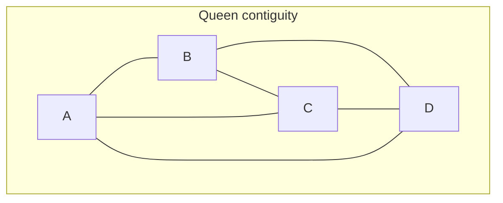

# Spatial weights: decide which places are connected

Stable ID: `SA-METHOD-SPATIAL-WEIGHTS-MATRIX` · Draft 0.1 · Source compendium section 1, page 2

## Start with the question

A spatial statistic needs to know which places count as neighbours. A map alone does not tell the computer what “nearby” means.

Should two districts be neighbours when they share an edge? Is touching at a corner enough? Should places within two kilometres be connected? Should every place be linked to its four nearest neighbours?

A spatial weights matrix makes that choice explicit.

**Spatial weights describe which locations are connected and how strongly each connection contributes to the analysis.**

They are not a neutral setup detail. They are part of the model.

## The matrix

For $n$ spatial units, a spatial weights matrix $W$ has $n$ rows and $n$ columns. The element $w_{ij}$ records the weight from unit $i$ to unit $j$.

For binary weights:

$$
w_{ij} =
\begin{cases}
1 & \text{if } i \text{ and } j \text{ are neighbours}\\
0 & \text{otherwise}
\end{cases}
$$

Usually, self-weights are zero:

$$
w_{ii}=0
$$

A spatial lag applies the weights to a variable (y):

$$
(Wy)_i = \sum_{j=1}^{n}w_{ij}y_j
$$

The spatial lag is a weighted summary of neighbouring values. Row-standardised weights turn it into a weighted neighbourhood average when the row has at least one neighbour.

## Four common ways to define neighbours

### 1. Rook contiguity

Two polygons are neighbours when they share an edge. A shared corner alone does not count.

### 2. Queen contiguity

Two polygons are neighbours when they share an edge or at least one vertex. Queen contiguity generally includes every Rook neighbour and may add corner-only neighbours.

### 3. Distance band

Two locations are neighbours when the distance between them is at or below a chosen threshold.

The distance must use meaningful units. A threshold of 1,000 means something different in metres, feet or degrees. For most local distance analysis, use an appropriate projected coordinate reference system.

### 4. k-nearest neighbours

Each location is connected to its (k) nearest locations. This guarantees a chosen number of outgoing neighbours for each unit, but the relationship may be asymmetric: A may choose B even when B does not choose A.

The value of (k), distance metric and any symmetrisation rule should be recorded.

## A small example

Four square cells form a 2-by-2 grid. Rook contiguity connects cells that share an edge. Queen contiguity also connects the two diagonal pairs that touch at the centre point.



In this particular 2-by-2 arrangement, every cell touches every other cell at an edge or vertex. The Rook graph omits the two diagonal links.

The notebook shows both matrices side by side so you can inspect exactly which relationships are added.

## Binary weights and row standardisation

Binary weights record only whether a relationship exists. Row standardisation rescales each nonzero row so its weights sum to one:

$$
w_{ij}^{(R)} =
\begin{cases}
\dfrac{w_{ij}}{\sum_{j=1}^{n}w_{ij}} & \text{if the row sum is positive}\\
0 & \text{if the row has no neighbours}
\end{cases}
$$

This makes a spatial lag a weighted neighbourhood average. It does not make every spatial analysis better.

- Binary weights give each neighbour a unit contribution.
- Row-standardised weights give each non-isolated unit a total outgoing weight of one.
- Perimeter weights can give more weight to polygons that share longer boundaries.
- Distance-decay and kernel weights can give closer units more influence.

A row-standardised matrix can be asymmetric even when the original binary contiguity matrix is symmetric, because units may have different numbers of neighbours.

## Islands and disconnected places

A unit with no neighbours is often called an *island* or isolate.

This can happen because:
- the distance threshold is too small;
- a polygon is geographically isolated;
- the data contain gaps or topology errors;
- the chosen contiguity rule does not connect corner-only contacts.

Do not silently drop islands. Report them and decide whether to keep them, change the neighbourhood definition, use a different model or treat the units separately. A row-standardisation step cannot invent missing neighbours.

## Spatial weights are not one-size-fits-all

The same dataset can produce different statistics under different weights. For example:
- Rook and Queen contiguity may define different neighbour sets.
- A distance band changes when its threshold changes.
- k-nearest neighbours fixes the number of outgoing links but may create asymmetric relationships.
- Row standardisation changes the influence of each neighbour.

For a defensible analysis, choose weights based on the process being studied. Administrative adjacency, travel access, environmental diffusion and social interaction may require different neighbourhood definitions.

## Build weights with current PySAL Graph API

The current `libpysal.graph.Graph` interface can build contiguity, distance-band and k-nearest-neighbour relationships.

```python
from libpysal import graph

# gdf must contain valid polygon geometries.
rook = graph.Graph.build_contiguity(gdf, rook=True)
queen = graph.Graph.build_contiguity(gdf, rook=False)

# Row-standardise a copy of the binary contiguity graph.
queen_row_standardised = queen.transform("r")

# Build distance-based weights from projected centroids.
centroids = gdf.geometry.centroid
distance_band = graph.Graph.build_distance_band(
    centroids,
    threshold=1000,
)

# Build a k-nearest-neighbour graph from the same projected centroids.
knn = graph.Graph.build_knn(centroids, k=4)

print(queen.summary())
print("Islands:", queen.isolates)
```

In the current Graph API, `rook=True` means shared-edge contiguity; `rook=False` means Queen contiguity. The Graph API is the newer libpysal interface. The migration guide explains how it relates to the older `W` weights class.

The contiguity builder assumes polygon coverage: neighbouring polygons should share boundary segments or points. Gaps, overlaps and mismatched digitising can affect the result. The `strict` option changes how contiguity is detected; consult the API before using it on imperfect geometries.

## Explore it in the notebook

The interactive notebook builds a four-cell grid and compares:
- Rook and Queen adjacency;
- binary and row-standardised weights;
- a distance-band graph;
- a k-nearest-neighbour graph;
- the row sums and isolates in each graph.

- [Interactive spatial weights notebook](../notebooks/spatial-weights-lab.ipynb)

## How weights connect to the other lessons

Spatial weights are used by:
- [Global Moran's I](../algorithms/statistics/global-morans-i.md);
- [Global Geary's C](../algorithms/statistics/gearys-c.md);
- [Local Moran's I](../algorithms/statistics/local-morans-i.md);
- [Local Geary](../algorithms/statistics/local-geary.md);
- [Getis-Ord G and Gi*](../algorithms/statistics/global-getis-ord-g.md).

Always record the weights definition alongside the statistic. Reporting “Moran's I = 0.3” without explaining the weights leaves out a central part of the analysis.

## Have a go

1. Build the Rook and Queen graphs for the four-cell grid. Which two extra links does Queen add?
2. Row-standardise the Queen graph. Why do the row sums become one?
3. Add a fifth isolated polygon. How does the graph represent it?
4. Increase the distance-band threshold. When do previously isolated units gain neighbours?
5. Build a k-nearest-neighbour graph with $k=1$. Is it symmetric?
6. Calculate Global Moran's I with both binary and row-standardised weights. Explain why the result can change.
7. Choose a neighbourhood rule for a transport-access question. Would contiguity or travel time better represent the process?

## References

- PySAL `libpysal`. [Graph API reference](https://pysal.org/libpysal/stable/generated/libpysal.graph.Graph.html), including contiguity, distance-band, k-nearest-neighbour builders, transformations and isolates.
- PySAL `libpysal`. [W to Graph migration guide](https://pysal.org/libpysal/stable/user-guide/graph/w_g_migration.html).
- PySAL `libpysal`. [Graph implementation source](https://pysal.org/libpysal/v4.14.1/_modules/libpysal/graph/base.html).

## What this lesson does not claim

- There is no universally correct spatial weights matrix.
- Queen contiguity is not always preferable to Rook contiguity.
- Row standardisation does not solve islands or disconnected graphs.
- k-nearest-neighbour relationships are not necessarily symmetric.
- A spatial weights matrix does not by itself establish a causal process.

## Change history

| Version | Date | Change |
|---|---|---|
| 0.1 | 2026-11-13 | Initial reader-facing guide to contiguity, distance bands, kNN and weights transformations |
