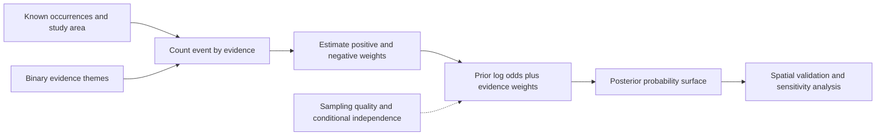

# Weights of evidence: combine binary spatial evidence

A mineral prospectivity map may combine mapped faults, favourable lithology, geochemical anomalies and geophysical responses. Each layer provides evidence, but the layers do not necessarily have the same predictive strength.

**Weights of evidence (WofE)** is a Bayesian, data-driven method for combining binary evidence patterns with known occurrences of a target event. It estimates how strongly the presence or absence of each evidence theme is associated with known occurrences, then adds those contributions in log-odds space.

It is not a generic replacement for weighted linear combination (WLC). WLC encodes relative preferences; WofE estimates evidence associations from labelled observations and depends on a conditional-independence assumption.

## 1. Define the event and the study area

Choose a target event \(D\), such as the presence of a mineral deposit, and define the analysis area. The event must be represented by known occurrence locations or cells. Each evidence theme \(B_i\) must be converted into a binary layer:

- \(B_i=1\): the evidence is present;
- \(B_i=0\): the evidence is absent.

For example, a fault-proximity layer might mark cells within a documented distance of a fault. The distance threshold is a modelling choice and must be recorded. A continuous geochemical measurement is not binary evidence until a defensible threshold or classification rule is applied.

All layers must refer to the same spatial support. For raster analysis, align the CRS, grid origin, resolution, dimensions and study-area mask before counting cells. Do not let resampling silently change a binary class.

## 2. Estimate the weight for evidence presence

For one evidence theme \(B\), count cells in the four combinations of event and evidence:

| | Evidence present \(B=1\) | Evidence absent \(B=0\) |
|---|---:|---:|
| Event present \(D=1\) | \(n_{11}\) | \(n_{10}\) |
| Event absent \(D=0\) | \(n_{01}\) | \(n_{00}\) |

The positive weight is the log ratio of the conditional probabilities:

\[
W^+ = \ln\left(\frac{P(B\mid D)}{P(B\mid \neg D)}\right)
\]

A positive \(W^+\) means the evidence occurs more often where the event is known than where it is not. A negative value means it is less common in event cells.

## 3. Estimate the weight for evidence absence

Absence can also carry information:

\[
W^- = \ln\left(\frac{P(\neg B\mid D)}{P(\neg B\mid \neg D)}\right)
\]

If \(W^-\) is strongly negative, the event is rarely observed where the evidence is absent. If it is close to zero, absence contributes little information.

The contrast is:

\[
C = W^+ - W^-
\]

A larger positive contrast indicates a stronger difference between the event association of presence and absence. It is a descriptive diagnostic, not proof that the evidence is causally related to the event.

## 4. Combine evidence in log-odds space

The prior odds of the event are:

\[
O(D)=\frac{P(D)}{1-P(D)}
\]

For a cell with evidence pattern \(B_1,\ldots,B_m\), the posterior log odds under the conditional-independence model are:

\[
\ln O(D\mid B_1,\ldots,B_m)
=
\ln O(D)+\sum_{i=1}^{m}W_i
\]

where \(W_i=W_i^+\) when evidence \(i\) is present and \(W_i=W_i^-\) when it is absent.

Convert log odds to probability with the logistic function:

\[
P(D\mid B_1,\ldots,B_m)
=
\frac{1}{1+\exp[-\ln O(D\mid B_1,\ldots,B_m)]}
\]

The result is a model-based posterior probability only to the extent that the event labels, evidence definitions, sampling design and assumptions support that interpretation. It is not automatically a calibrated probability of discovery.

## 5. The key assumption: conditional independence

The standard additive WofE model requires the evidence themes to be approximately conditionally independent with respect to the target-event occurrence pattern, as defined in the WofE literature. Agterberg and Cheng formalise this condition for the deposit-pattern indicators used in the model and develop an omnibus test based on the expected sum of posterior probabilities. Do not casually replace this specialised assumption with the stronger-sounding claim that the evidence layers are mutually independent in both event and non-event populations.

That assumption is often difficult to defend. For example, distance to a mapped fault and a fault-density layer may encode overlapping information. Adding both as if they were independent can count the same signal more than once and produce overconfident posterior odds.

Before combining themes:

1. Explain the geological or domain rationale for each evidence layer.
2. Inspect pairwise associations and spatial overlap.
3. Test the WofE conditional-independence assumption using a method appropriate to the event-pattern model; the Agterberg–Cheng omnibus test is a primary reference.
4. Remove, combine or model dependent themes when justified.
5. Compare predictions with spatially independent validation data.

A simple correlation matrix is a useful screening tool, not a complete conditional-independence test.

## 6. Zero counts and smoothing

If any cell count is zero, an unsmoothed conditional probability may be zero and its logarithm undefined. The teaching implementation supports an additive pseudocount \(\alpha\) in each cell of the 2-by-2 table:

\[
\widehat P(B\mid D)=\frac{n_{11}+\alpha}{n_{11}+n_{10}+2\alpha}
\]

The same adjustment is applied to the other three conditional probabilities. A value such as \(\alpha=0.5\) is a transparent Jeffreys-style stabilisation for a binomial proportion; it changes the estimates and must be reported. It is not a cure for sparse, biased or unrepresentative occurrence data. Set \(\alpha=0\) only when every required conditional count is non-zero.

## 7. Sampling, spatial support and validation

The counts are only meaningful relative to the study-area definition and sampling process.

- Record how occurrence locations were collected, geocoded and deduplicated.
- Consider spatial clustering and uneven exploration effort; mapped absence may mean “not observed” rather than “not present”.
- Keep training occurrences separate from independent validation occurrences.
- Use spatially separated validation where nearby cells would otherwise leak information.
- Test sensitivity to evidence thresholds, grid resolution, study-area boundaries and pseudocount choice.
- Report the prior event prevalence and the evidence weights alongside any map.
- Do not interpret a high score as a discovery guarantee or as a causal explanation.

Classical WofE treatments can represent a missing evidence theme as a third state and leave the prior logit unchanged for that cell. This package deliberately uses a stricter complete-case policy: a cell is scored only when the event and every evidence theme are present. The included NumPy implementation is a small, auditable baseline for aligned 2D binary arrays. It does not construct evidence themes, georeference data, test conditional independence, correct sampling bias or perform spatial cross-validation.

## 8. Worked calculation

Suppose a study area has 100 valid cells, 20 of which contain known occurrences. One binary evidence theme is present in 15 occurrence cells and 20 non-occurrence cells:

- \(n_{11}=15\), \(n_{10}=5\);
- \(n_{01}=20\), \(n_{00}=60\).

Then:

\[
P(B\mid D)=15/20=0.75
\qquad
P(B\mid\neg D)=20/80=0.25
\]

\[
W^+=\ln(0.75/0.25)=\ln 3\approx1.099
\]

For absence:

\[
P(\neg B\mid D)=5/20=0.25
\qquad
P(\neg B\mid\neg D)=60/80=0.75
\]

\[
W^-=\ln(0.25/0.75)=-\ln 3\approx-1.099
\]

The prior probability is \(0.20\), so the prior odds are \(0.20/0.80=0.25\). A cell where the evidence is present has posterior odds \(0.25\times3=0.75\), corresponding to probability \(0.75/(1+0.75)\approx0.429\). A cell where the evidence is absent has posterior odds \(0.25/3\approx0.0833\), corresponding to probability about \(0.077\).

This is a one-theme illustration. With several themes, the additive calculation is defensible only when the conditional-independence model is appropriate.

## 9. When to use it—and when not to

Use WofE when the target event has credible occurrence labels, the evidence themes can be meaningfully represented as binary patterns, and the conditional-independence assumption can be examined.

Do not use it as a shortcut when:
- occurrence data are sparse, spatially biased or poorly located;
- evidence layers are strongly dependent and cannot be defensibly separated;
- the task is to encode stakeholder preferences rather than learn associations from observations;
- the event is not meaningfully represented by binary presence/absence;
- the output will be presented as calibrated risk without calibration and validation.

For preference-driven suitability, compare [weighted linear combination](weighted-linear-combination.md), [AHP](analytic-hierarchy-process.md), [ordered weighted averaging](ordered-weighted-averaging.md) and [TOPSIS](topsis.md). These answer different questions.

## References

- Bonham-Carter, G. F. (1994). *Geographic Information Systems for Geoscientists: Modelling with GIS*. Pergamon. https://doi.org/10.1016/C2013-0-03864-9. A foundational treatment of GIS-based weights-of-evidence modelling.
- Agterberg, F. P., & Cheng, Q. (2002). Conditional independence test for weights-of-evidence modeling. *Natural Resources Research*, 11(4), 249–255. https://doi.org/10.1023/A:1021193827501
- Raines, G. L. (1999). Evaluation of weights of evidence to predict epithermal-gold deposits in the Great Basin of the western United States. *Natural Resources Research*, 8, 257–276. https://doi.org/10.1023/A:1021602316101.
- Agterberg, F. P., Bonham-Carter, G. F., & Wright, D. F. (1990). Statistical pattern integration for mineral exploration. In *Computer Applications in Resource Estimation: Prediction and Assessment for Metals and Petroleum*, 1–21. https://doi.org/10.1016/B978-0-08-037245-7.50006-8.

The implementation and walkthrough are linked from [the Python package](../implementations/python/weights-of-evidence/README.md).
